# Product Requirements Document (PRD)
# Indonesia Export Charges Registry — Export Duty (Bea Keluar) & Export Levy (Pungutan Ekspor)

| Field | Value |
|---|---|
| Product (working name) | **Export Charges Registry (ECR)** |
| Document version | 1.3 — Draft for review; aligned with the build (30 Oct 2026): DWS Hub owns who may use ECR (no ECR invitations or access requests), ECR authenticator step-up for privileged roles, change-set and calculator decisions taken during the build. 1.2: DWS Hub OIDC contract, duty and levy rules checked against PMK 214/2008 and PMK 69/2025 (28 Oct 2026) |
| Date | 30 October 2026 |
| Document owner | Jerry Hakim |
| Status | Draft — pending sign-off by Business Owner, Tax/Customs, IT Security |
| Predecessor artefact | `assets/Indo HS code and tarif.html` (prototype, compiled 14 Aug 2026) |
| Related document | `docs/01-Review-of-Current-HTML.md` (critique of the prototype) |
| Shared version | Claude Doc https://claude.ai/artifact/Umcxp12WubaAS6Zj6dtrvv — the copy reviewers comment on |
| Technical design | Claude Doc https://claude.ai/artifact/N3ra2W5pRNhqqvZKRCiMYf |
| Build status | §15.1 — what is built as of 30 Oct 2026 |

### Sign-off

| Role | Name | Decision | Date |
|---|---|---|---|
| Business Owner (Commercial / Export) | _tbd_ | | |
| Tax & Customs Lead | _tbd_ | | |
| IT Security | _tbd_ | | |
| IT Delivery Lead | _tbd_ | | |

---

## Table of contents

1. Executive summary
2. Background & problem statement
3. Goals, non-goals & success metrics
4. Users, personas & roles
5. Scope & release phasing
6. Business processes — L0, L1, L2
7. Functional requirements
8. User access control (RBAC) — permission matrix
9. Data model & calculation rules
10. Non-functional requirements
11. User stories — positive & negative (per functionality)
12. Screen inventory
13. Integrations & API
14. Data migration from the prototype
15. Release plan
16. Risks & mitigations
17. Assumptions, dependencies & open questions
18. Glossary
19. Appendix — traceability from prototype critique to requirements

---

## 1. Executive summary

Indonesian exporters must apply two independent government charges at the time of export:

* **Export Duty — *Bea Keluar (BK)*** — collected by Customs (DJBC) under the PMK on export-duty goods and tariffs. Palm products use a stepped USD/MT table driven by the monthly CPO reference price; other goods use ad-valorem percentages of an export base price; cocoa steps with the cocoa reference price.
* **Export Levy — *Pungutan Ekspor (PE)*** — collected for the plantation fund agency (BPDP / formerly BPDPKS) under the PMK on levy tariffs, as a percentage of the reference price or a fixed USD/MT.

Both depend on **product identity** (official classification + technical parameters), **HS code (BTKI)**, the **applicable regulation version** and a **periodic reference price**. Rules change frequently (several PMK amendments per year; reference prices monthly), and a wrong classification is the most common cause of re-assessment.

The prototype HTML proves the data model for palm derivatives but is a static file with no governance. **ECR** turns it into a production, multi-commodity, effective-dated **system of record** with:

1. A **Regulation Register** and a **product/tariff master** covering every **palm oil** product (CPO and derivatives) in the duty and levy schedules, modelled so other commodities can be added later.
2. **Effective-dated** rates, reference prices and FX, so any shipment date can be priced.
3. A **charge calculator** (per MT and per shipment, USD and IDR) with shared-HS risk warnings.
4. **Maker-checker publishing**, version history, diff and rollback.
5. **Single sign-on through DWS Hub (DWS Hub decides who may use ECR), role-based access control (RBAC) with an authenticator code for privileged roles, office-network and VPN-only access** and an immutable **audit trail**.

---

## 2. Background & problem statement

### 2.1 Current state
* Charges are researched manually from PDFs (PMK, Permenperin, Kepmendag) and kept in personal spreadsheets or the prototype HTML.
* The prototype covers 143 products (122 palm, 21 non-palm), one reference price at a time, no history, no access control (see review doc §3).

### 2.2 Problems

| # | Problem | Consequence |
|---|---|---|
| P1 | No single, authoritative, versioned source for BK/PE rates across all commodities | Inconsistent figures across Commercial, Finance, Tax, Logistics |
| P2 | No effective dating | Cannot verify historical shipments, reconcile accruals or defend audits |
| P3 | Classification relies on HS code alone in practice | Shared tariff posts lead to mis-declaration and re-assessment |
| P4 | Data updates are manual edits with no review | High risk of undetected rate errors |
| P5 | No access control or audit | Data can be altered and redistributed without accountability |

### 2.3 Opportunity
A governed registry reduces mis-declaration risk, speeds up pricing and export-cost estimation, and gives Tax/Customs an auditable trail of which rule applied to which shipment date.

---

## 3. Goals, non-goals & success metrics

### 3.1 Goals
| ID | Goal |
|---|---|
| G1 | Provide a structured, searchable list of **all palm oil products** (CPO and derivatives) subject to BK and/or PE, with legal basis for each charge. |
| G2 | Calculate BK and PE correctly for any product, quantity and **as-of date**. |
| G3 | Make every published figure traceable to a regulation, annex, item number and approver. |
| G4 | Ensure only authorised, authenticated, MFA-verified staff can change data; all changes are reviewed (four-eyes). |
| G5 | Publish regulation changes within **2 business days** of promulgation. |

### 3.2 Non-goals (v1)
* Filing export declarations (PEB) or paying BK/PE — ECR is a reference & calculation tool, not a customs/payment channel.
* Legal advice. ECR displays a disclaimer; the regulation text prevails.
* Non-tariff export requirements (bans, export approvals, surveyor reports, export-proceeds retention, DMO) — **captured as an informational "Other obligations" note per product only**; a full module is Phase 3.
* Import duties.
* Non-palm commodities (cocoa, hides and skins, wood, metal minerals, pine resin): out of scope by decision (OQ-01); the data model can take them later.

### 3.3 Success metrics (KPIs)

| KPI | Target (6 months after go-live) |
|---|---|
| Schedule coverage — % of palm products in current BK & PE annexes loaded and published | 100 % |
| Calculation accuracy vs. Tax-team sample (≥ 50 historical shipments) | 100 % match |
| Median time from regulation promulgation to publication | ≤ 2 business days |
| Rate changes published without checker approval | 0 |
| Active monthly users (Viewer and above) | ≥ 80 % of target user base |
| Critical/High security findings open at go-live (pen-test) | 0 |
| Search p95 response time | ≤ 500 ms |

---

## 4. Users, personas & roles

### 4.1 Personas

| Persona | Typical job | Needs |
|---|---|---|
| **Export Commercial Officer** | Prices export contracts | Quick per-MT charge at current reference price; compare products |
| **Tax / Customs Specialist** | Validates PEB, handles audits | Legal basis, historical as-of calculation, shared-HS warnings, export to evidence pack |
| **Finance / Accounting** | Accrues export charges | Shipment-level totals in USD & IDR, period exports |
| **Logistics / Shipping** | Prepares shipping documents | HS code and spec parameters per product |
| **Regulatory Analyst (Maker)** | Monitors regulation, maintains data | Efficient data entry, bulk import, validation |
| **Regulatory Approver (Checker)** | Senior tax/legal | Clear diff of changes, approve/reject with comments |
| **User Administrator** | IT / business admin | Assign roles, deactivate users, reset authenticators (access to ECR itself is granted in DWS Hub) |
| **Super Administrator** | IT platform owner | System configuration, admin management, break-glass |
| **Internal Auditor** | Internal audit / compliance | Read-only access to audit trail and all versions |

### 4.2 System roles (summary — full matrix in §8)

| Role code | Role | Privileged? | MFA |
|---|---|---|---|
| `GUEST` | Not used — no public or guest access (OQ-04) | No | n/a |
| `VIEWER` | Read, search, calculate, export | No | Per DWS Hub policy |
| `MAKER` | Create/edit drafts, import | Yes | **Mandatory** |
| `CHECKER` | Review, approve/reject, publish, rollback | Yes | **Mandatory** |
| `USER_ADMIN` | Manage users & role assignment (not data) | Yes | **Mandatory** |
| `AUDITOR` | Read-only access to audit log and versions | Yes | **Mandatory** |
| `SUPER_ADMIN` | Full system administration | Yes | **Mandatory** |

Segregation-of-duties (SoD) rules:
* **SoD-1** A user cannot approve a change set they created or edited.
* **SoD-2** `USER_ADMIN` cannot hold `MAKER` or `CHECKER` simultaneously (configurable warning → block).
* **SoD-3** A user cannot change their own roles or account status.
* **SoD-4** At least **two** active `SUPER_ADMIN` accounts must exist (after bootstrap); any deactivation or demotion that would leave fewer than two is blocked.

---

## 5. Scope & release phasing

| Area | MVP (Release 1) | Release 2 | Release 3 |
|---|---|---|---|
| Identity & access | DWS Hub SSO (access to ECR granted in DWS Hub), account created at first sign-in with a default role, bootstrap of the first Super Admins, ECR authenticator (TOTP) for privileged roles with step-up, local break-glass login with TOTP and password reset, session mgmt, user & role management, access review, office/VPN-only network access | Passkeys for break-glass accounts | — |
| Regulation & master data | Regulation register, official source registry and document links, commodities, products, HS (BTKI), BK & PE schedules, reference prices, FX, Excel import, maker-checker, versioning, rollback | Automated monitoring alerts of official sources | AI-assisted extraction from PMK PDFs (human-approved) |
| Consumption | Catalogue, search, filters, sort, detail, calculator (per MT & shipment, USD/IDR), as-of date, shared-HS view, CSV/XLSX export, PDF evidence pack, permalink, KPI tiles | Change subscriptions/notifications, period comparison | Non-tariff obligations module |
| Governance | Audit trail, data-quality checks, system configuration | Scheduled DQ reports | — |
| Integration | — | Read-only REST API with API keys | ERP (SAP) / logistics platform integration for shipment costing |
| Languages | English + Bahasa Indonesia UI labels; legal text as published | Full bilingual content fields | — |
| Commodities | Palm oil, CPO and all derivatives, including mixtures | — | Other commodities, if required |

---

## 6. Business processes — L0, L1, L2

### 6.1 L0 — End-to-end value chain

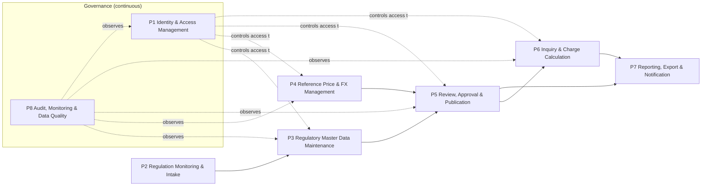

| L0 ID | Process | Purpose | Primary actors | Key outputs |
|---|---|---|---|---|
| P1 | Identity & Access Management | Ensure only verified, authorised users access functions matching their role | Super Admin, User Admin, all users | Active accounts, role assignments, sessions |
| P2 | Regulation Monitoring & Intake | Detect and register new/amended regulations and reference-price decrees | Maker | Regulation records (draft), source documents, impact list |
| P3 | Regulatory Master Data Maintenance | Maintain commodities, products, HS mappings, BK and PE schedules | Maker | Draft change sets |
| P4 | Reference Price & FX Management | Record periodic reference prices (CPO, cocoa, export base prices) and FX rates | Maker | Draft price/FX records |
| P5 | Review, Approval & Publication | Four-eyes validation and effective-dated publishing | Checker | Published versions, rejections, rollbacks |
| P6 | Inquiry & Charge Calculation | Let users find products and compute BK/PE for a date & quantity | Viewer (and above) | Search results, calculations |
| P7 | Reporting, Export & Notification | Distribute data and changes | Viewer, Checker, System | Exports, permalinks, change bulletins |
| P8 | Audit, Monitoring & Data Quality | Evidence, security monitoring and data integrity | Auditor, Super Admin, System | Audit log, DQ findings, security alerts |

---

### 6.2 L1 — Sub-processes per L0

#### P1 Identity & Access Management

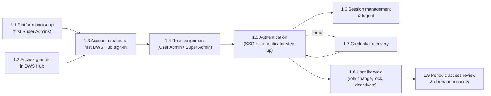

| L1 | Name | Trigger | Actor | Output |
|---|---|---|---|---|
| 1.1 | Platform bootstrap | First deployment | Operator + nominated Super Admins | Two Super Admins granted by command after their first sign-in |
| 1.2 | Access granted in DWS Hub | Staff need ECR | DWS Hub administrator (outside ECR) | ECR assigned to the person in DWS Hub |
| 1.3 | Account created at first sign-in | First DWS Hub sign-in to ECR | User, System | ECR account `ACTIVE` with the default role (Viewer) |
| 1.4 | Role assignment | Job needs a privileged role | User Admin / Super Admin | Roles changed; the person's sessions end |
| 1.5 | Authentication | User signs in | User, System | Authenticated session |
| 1.6 | Session management | Idle/absolute timeout, logout | User, System | Terminated sessions |
| 1.7 | Credential recovery | Forgotten password / lost MFA device on a local account (SSO users recover at DWS Hub) | User, User Admin | Password reset, MFA reset |
| 1.8 | User lifecycle | Role change, leaver, lockout | User Admin | Updated roles/status |
| 1.9 | Periodic access review | Quarterly / 90-day dormancy | User Admin, System | Review attestation, auto-disabled dormant accounts |

#### P2 Regulation Monitoring & Intake

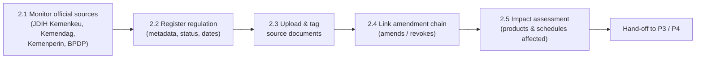

#### P3 Regulatory Master Data Maintenance

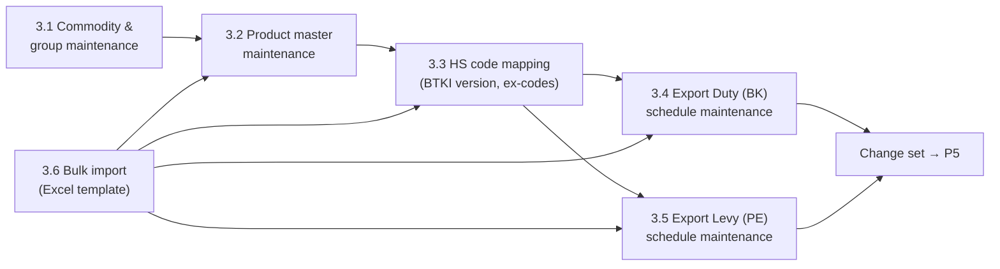

#### P4 Reference Price & FX Management

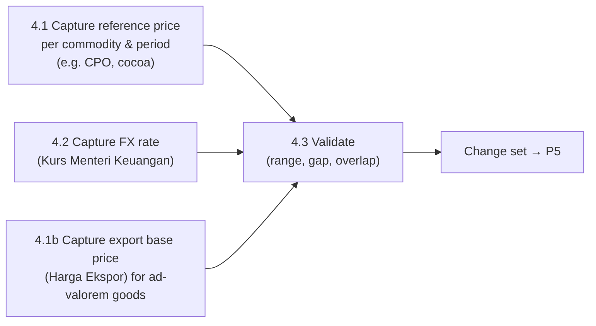

#### P5 Review, Approval & Publication

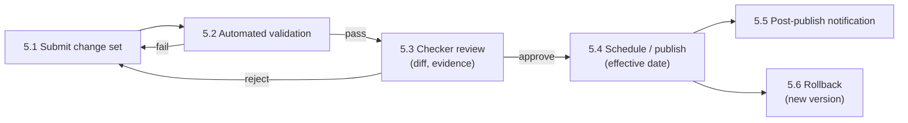

#### P6 Inquiry & Charge Calculation

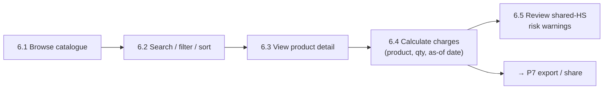

#### P7 Reporting, Export & Notification

| L1 | Name | Description |
|---|---|---|
| 7.1 | Export list / calculation | CSV, XLSX (MVP); PDF evidence pack (R2) |
| 7.2 | Permalink | Shareable URL encoding filters, as-of date and calculator inputs (no personal data) |
| 7.3 | Change subscription | Users subscribe to commodities/products; notified on publish (R2) |
| 7.4 | Change bulletin | Automatically generated summary of each published version |

#### P8 Audit, Monitoring & Data Quality

| L1 | Name | Description |
|---|---|---|
| 8.1 | Audit capture | Every create/update/delete/approve/login/role change written to append-only log |
| 8.2 | Audit review | Auditor searches and exports audit log |
| 8.3 | Data-quality checks | Rule engine runs on every change set and nightly on published data |
| 8.4 | Security monitoring | Failed-login spikes, lockouts, MFA resets, privilege changes alert Super Admin |

---

### 6.3 L2 — Detailed process flows

Notation: **Actor** = who acts; **System** = ECR behaviour; **BR** = business rule reference.

#### L2-1.1 Platform bootstrap (first Super Admins)

| Step | Actor | Action | System response / rule |
|---|---|---|---|
| 1 | Nominated Super Admins | Each signs in to ECR once through DWS Hub | Account created with the default role (L2-1.2) |
| 2 | Operator | Runs `grant:role --email … --role SUPER_ADMIN --reason …` on the BE server for each | Refuses unknown or inactive accounts; audit `ROLE_GRANTED_CLI` with the OS user; the person's sessions end |
| 3 | Super Admin | Signs in again and sets up the ECR authenticator | Required before any privileged function (BR-IAM-13) |
| 4 | Super Admins | Manage all further roles in *Users* | Two active Super Admins required from then on (SoD-4) |

#### L2-1.2 Account creation at first DWS Hub sign-in

DWS Hub decides who may use ECR: its administrators assign ECR to people, and DWS Hub handles invitations and access requests. ECR creates the account the first time a person signs in and owns roles, account status, sessions and the audit trail.

| Step | Actor | Action | System response / rule |
|---|---|---|---|
| 1 | User | Opens ECR or its tile in DWS Hub | Sign-in through DWS Hub (F-13) |
| 2 | System | Verifies the ID token and looks up the Hub `sub` | Known `sub`: signs in, refreshes name and email |
| 3 | System | Unknown `sub` and no ECR account with that email | Creates the account `ACTIVE` with the default role(s), Viewer by default (BR-IAM-12); audit `USER_PROVISIONED` |
| 4 | System | Unknown `sub` but the email belongs to another ECR account | Refused, "This email already belongs to another ECR account" (`LOGIN_IDENTITY_CONFLICT`); a User Admin resolves it |
| 5 | System | Hub token without an email | Refused (`LOGIN_NO_EMAIL`) |

#### L2-1.3 Role assignment

| Step | Actor | Action | System response / rule |
|---|---|---|---|
| 1 | User Admin | Opens *Users*, selects a person, ticks roles, enters a reason | BR-IAM-02: User Admin grants Viewer, Maker, Checker, Auditor; only a Super Admin manages User Admin and Super Admin roles or accounts |
| 2 | System | Asks for an authenticator code if the last one is older than 5 minutes | Step-up (BR-IAM-13) |
| 3 | System | Checks segregation of duties | SoD-2 (User Admin with Maker or Checker), SoD-3 (own account), SoD-4 (two Super Admins) |
| 4 | System | Saves the roles and ends the person's sessions | New roles apply at the next sign-in; audit `ROLES_CHANGED` with before, after and reason |
| 5 | Person | Signs in again; a privileged role requires setting up the authenticator first | BR-IAM-13 |

#### L2-1.5 Authentication (login + MFA)

All users sign in through DWS Hub SSO; ECR receives the verified identity and applies its own roles, sessions and audit. Users in privileged roles also set up an authenticator app in ECR and enter a code before sensitive actions (BR-IAM-13). The password steps below apply only to local break-glass Super Admin accounts (not built yet, §15.1).

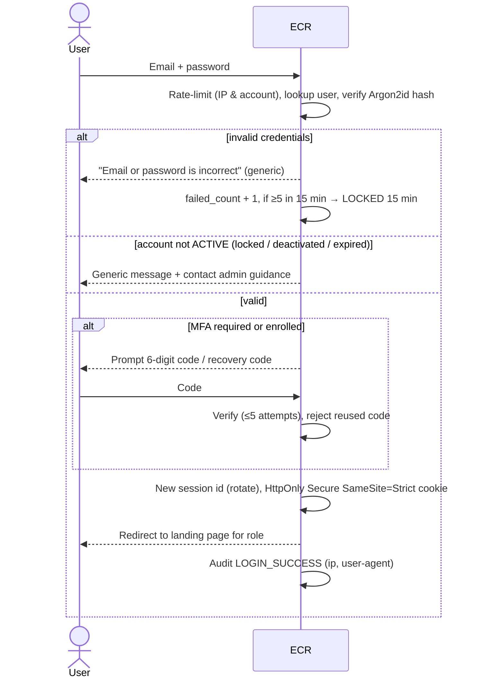

| Step | Actor | Action | System response / rule |
|---|---|---|---|
| 1 | User | Enters email + password | TLS only; no credentials in URL |
| 2 | System | Verifies; generic error on any failure | BR-IAM-09 |
| 3 | System | Lockout after 5 failures / 15 min, auto-unlock after 15 min, or User Admin unlock | BR-IAM-06 |
| 4 | User | Enters MFA code | Privileged roles always; Viewer if enrolled or policy-enforced |
| 5 | System | Creates session; forces password change if flagged (admin reset) | BR-IAM-07 |
| 6 | System | If password expired by policy or breached-list hit at login → force change | — |

#### L2-1.6 Session management & logout

| Step | Actor | Action | System response / rule |
|---|---|---|---|
| 1 | System | Tracks activity | Idle timeout 30 min (privileged 15 min); absolute 8 h (BR-IAM-08) |
| 2 | System | 2 min before idle timeout shows countdown dialog | "Stay signed in" extends idle only |
| 3 | User | Clicks *Sign out* | Server-side session destroyed; cookie cleared; audit `LOGOUT` |
| 4 | System | Step-up with an ECR authenticator or recovery code before: approve, reject or cancel a schedule, rollback, role change, deactivate or reactivate, authenticator reset, system config | Valid 5 min |
| 5 | User / Admin | "Sign out all other sessions" / User Admin "Revoke sessions" | All other sessions invalidated |

#### L2-1.7 Credential recovery

SSO users reset passwords and MFA at DWS Hub; the steps below apply to local break-glass accounts.

| Step | Actor | Action | System response / rule |
|---|---|---|---|
| 1 | User | *Forgot password* → enters email | Always "If an account exists, we have sent a link" (BR-IAM-09) |
| 2 | System | Sends reset link (single use, 30 min) only to `ACTIVE`/`LOCKED` accounts | Rate-limit 3 / hour / account |
| 3 | User | Sets new password; must pass MFA if enrolled | Previous 5 passwords disallowed |
| 4 | System | Invalidates all sessions; emails confirmation "password changed" | Audit `PASSWORD_RESET` |
| 5 | User | Lost MFA device → uses recovery code **or** requests MFA reset | MFA reset only by `USER_ADMIN` (or `SUPER_ADMIN` for admins) after identity verification; user must re-enrol at next login |

#### L2-1.8 User lifecycle

| Step | Actor | Action | System response / rule |
|---|---|---|---|
| 1 | User Admin | Searches user; opens profile | Shows roles, status, last login, MFA status, sessions |
| 2 | User Admin | Changes roles | BR-IAM-02, SoD-2/3/4; step-up auth; user notified by email |
| 3 | User Admin | Deactivates (leaver) | Sessions revoked immediately; pending change sets of a Maker are reassigned or returned to Draft |
| 4 | User Admin | Reactivates | Reason required; the person signs in again through DWS Hub |
| 5 | User Admin | Unlocks / forces password reset / resets MFA | Audit with reason |
| 6 | System | Access expiry date reached | Status `EXPIRED`; user & admin notified 7 days before |

#### L2-1.9 Periodic access review & dormant accounts

| Step | Actor | Action | System response / rule |
|---|---|---|---|
| 1 | System | Nightly: accounts with no login for 90 days → `DORMANT_DISABLED` (BR-IAM-11) | Email notice at day 80 |
| 2 | System | Quarterly: generates access-review campaign (all users & roles) | Assigned to User Admins; Super Admin reviews admins |
| 3 | Reviewer | Confirms or revokes each assignment | Unreviewed after 14 days → escalation to Super Admin |
| 4 | System | Stores signed review report | Retained per BR-AUD-02 |

#### L2-2.2 Register a regulation

| Step | Actor | Action | System response / rule |
|---|---|---|---|
| 1 | Maker | *Regulations → New*; selects type (PMK, Permenperin, Permendag, Kepmendag, Perpres, other) | — |
| 2 | Maker | Enters number/year, title (ID & EN), issuer, status (`DRAFT_RANCANGAN`, `PROMULGATED`, `IN_FORCE`, `AMENDED`, `REVOKED`), promulgation date, effective date, end date | Number + year + type unique (BR-REG-01) |
| 3 | Maker | Links "amends / revokes / implements" relations | No circular amendment chain (BR-REG-02) |
| 4 | Maker | Uploads source documents (PDF, ≤ 25 MB, virus-scanned) and official URL | SHA-256 stored for integrity |
| 5 | Maker | Lists affected annexes (e.g., *Lampiran C*) and impacted products | Impact list auto-suggested from previous version |
| 6 | Maker | Saves as Draft → adds to change set | Not visible to Viewers until published |

#### L2-3.2 / 3.3 Product master & HS mapping

| Step | Actor | Action | System response / rule |
|---|---|---|---|
| 1 | Maker | Creates/edits product: commodity, classification group, item no. *as printed*, names (ID/EN), synonyms, definition, technical parameters (name, operator, value, unit), notes | Surrogate key generated; "as printed" number may duplicate (BR-PRD-02) |
| 2 | Maker | Adds HS mapping(s): BTKI version, 8-digit code, `ex` flag + qualifying description | Code must exist in selected BTKI version (BR-PRD-03); ex-code requires description |
| 3 | System | Detects other products on same HS code | Flags **shared tariff post**; shown to Maker and later to users (BR-PRD-04) |
| 4 | Maker | Sets validity (effective from/to) and links classification regulation | Required (BR-PRD-01) |
| 5 | Maker | Adds to change set | — |

#### L2-3.4 / 3.5 Duty & levy schedule maintenance

| Step | Actor | Action | System response / rule |
|---|---|---|---|
| 1 | Maker | Selects regulation version and schedule (BK Lampiran X / PE Lampiran Y) | Schedule belongs to exactly one regulation |
| 2 | Maker | Creates schedule line: *Kelompok*, item no., *uraian* (verbatim), linked product(s), basis type | Basis type: `BAND_USD_PER_MT`, `AD_VALOREM_PCT`, `PCT_OF_REF_PRICE`, `FIXED_USD_PER_MT`, `BAND_PCT` (e.g. cocoa), `ZERO_LISTED` |
| 3 | Maker | Enters rate data per basis (e.g. 17 band amounts against band table; or %) | Bands contiguous, non-overlapping, cover 0→∞ (BR-TRF-02); amounts ≥ 0 (BR-TRF-03); monotonic warning |
| 4 | Maker | Selects reference-price series used (CPO, cocoa, Harga Ekspor for product) | Required for band/%-of-ref bases (BR-TRF-04) |
| 5 | System | Shows impact preview: old vs new charge at current reference price for each linked product | — |
| 6 | Maker | Adds to change set | — |

#### L2-3.6 Bulk import

| Step | Actor | Action | System response / rule |
|---|---|---|---|
| 1 | Maker | Downloads versioned Excel template | Template version checked on upload |
| 2 | Maker | Uploads file (≤ 10 MB, `.xlsx`) | Virus scan; formula cells rejected (CSV/formula injection protection) |
| 3 | System | Parses & validates all rows (dry run) | Row-level errors/warnings report; nothing saved on error |
| 4 | Maker | Fixes and re-uploads, or accepts warnings | Errors block; warnings require acknowledgement |
| 5 | System | Creates one change set with all rows as Draft | Import id linked to every record (lineage) |

#### L2-4.1 / 4.2 Reference price & FX

| Step | Actor | Action | System response / rule |
|---|---|---|---|
| 1 | Maker | Selects series (CPO reference price, cocoa reference price, Harga Ekspor per product from MK/BC decisions, monthly or half-monthly; FX USD/IDR KMK) | — |
| 2 | Maker | Enters period start/end, value, currency/unit, source regulation (e.g. Kepmendag no.) and document | Periods for a series may not overlap (BR-REF-01); gaps flagged |
| 3 | System | Validates value vs. previous period (±30 % → warning) | BR-REF-02 |
| 4 | Maker | Adds to change set | Reference price publish is typically monthly; FX weekly |

#### L2-5 Maker-checker approval & publication

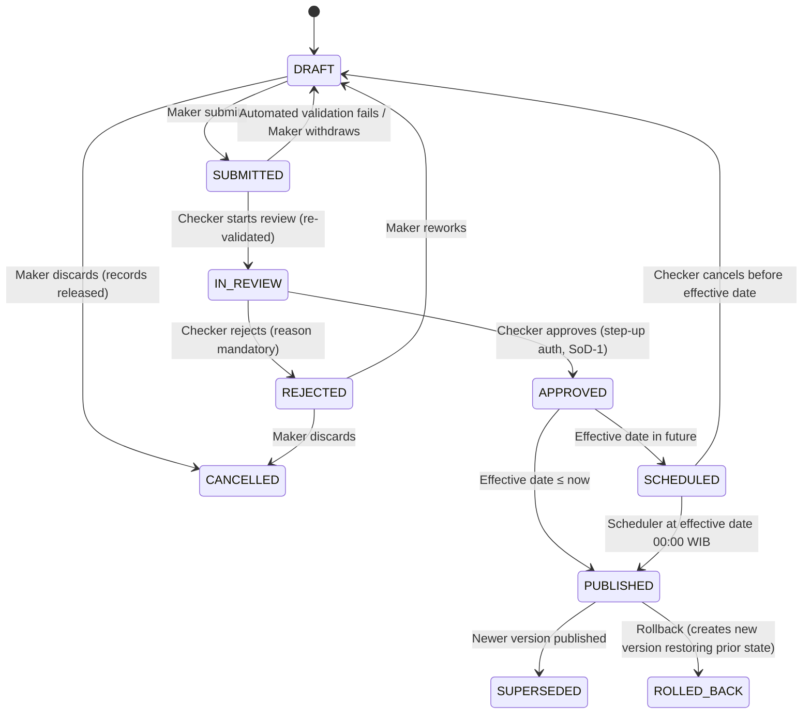

| Step | Actor | Action | System response / rule |
|---|---|---|---|
| 1 | Maker | Reviews change set summary, adds justification, submits | Automated validation (all BR-* and DQ rules): errors block; warnings must be acknowledged; a record can be open in only one change set at a time |
| 2 | System | Notifies Checkers | — |
| 3 | Checker | Starts the review (validation runs again against today's published data), reads the field-level diff, impact preview and source documents | Cannot review a set they created or edited (SoD-1); failing validation returns the set to the Maker |
| 4 | Checker | Approves (step-up auth) or rejects with comment per item or whole set | Partial approval not allowed in MVP (all-or-nothing) |
| 5 | System | Publishes at effective date (WIB, UTC+7); creates immutable version number | Version = monotonically increasing; bulletin generated |
| 6 | Checker | Rollback: selects published version → creates new change set restoring previous state → standard approval by a *different* Checker | Rollback is never a hard delete |

#### L2-6.4 Charge calculation

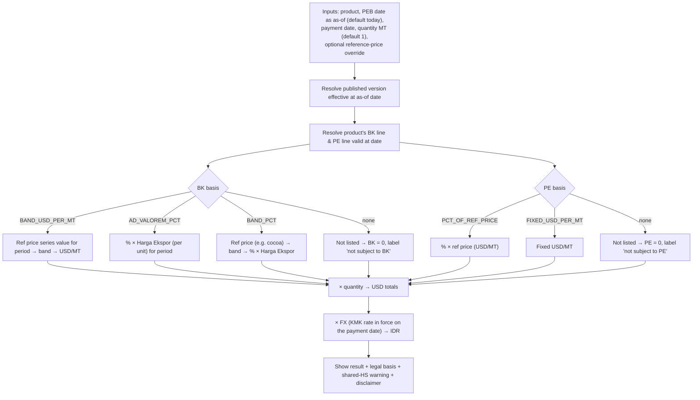

| Step | Actor | Action | System response / rule |
|---|---|---|---|
| 1 | User | Selects products (up to 50 lines), PEB date (as-of), payment date, quantities | Payment date at most 30 days before the PEB date (BR-CAL-11); a future date uses published data plus approved changes scheduled by then, and such a result cannot be saved (BR-CAT-02) |
| 2 | System | Resolves rules & prices for the date | A missing reference price or FX rate is named and the affected total stays empty; a missing next-period Harga Ekspor falls back to the previous period (BR-CAL-03) |
| 3 | User | (optional) Overrides reference price for "what-if" | Result clearly labelled **SIMULATION**, never exported as official |
| 4 | System | Displays per-MT and total in USD and IDR, the band used, the regulation/annex/item, and warnings | Rounding BR-CAL-05 |
| 5 | User | Saves the calculation (inputs, data version and result, replayable) or copies the permalink | → P7 |

#### L2-8.3 Data-quality checks

| Rule | Check | Severity |
|---|---|---|
| DQ-01 | Product without HS mapping | Error |
| DQ-02 | HS code not in BTKI version | Error |
| DQ-03 | Shared HS code between charged and uncharged products | Warning (shown to users) |
| DQ-04 | Duplicate "as printed" item number within group | Info (allowed, flagged) |
| DQ-05 | Missing definition or technical parameters for palm product | Warning |
| DQ-06 | Band table gap/overlap; band amounts decreasing | Error / Warning |
| DQ-07 | Reference-price period gap for an active series | Error (for current month) |
| DQ-08 | Schedule line not linked to any product, or product in schedule not in classification | Warning |
| DQ-09 | Regulation `IN_FORCE` past its end date | Warning |
| DQ-10 | Classification regulation still `DRAFT_RANCANGAN` | Info badge on all affected products |

---

## 7. Functional requirements

Priority: **M** = Must (MVP), **S** = Should (MVP if capacity, else R2), **C** = Could (R2+).

### 7.1 Identity & Access Management (IAM)

| ID | Requirement | Priority |
|---|---|---|
| FR-IAM-01 | System shall let an operator grant the first Super Admins by command after their first sign-in, audited; two are required (SoD-4). | M |
| FR-IAM-02 | System shall create an ECR account at a person's first DWS Hub sign-in with the configured default role(s) (default Viewer); DWS Hub decides who may use ECR. | M |
| FR-IAM-03 | System shall refuse a new Hub identity whose email already belongs to another ECR account, and a Hub token without an email, with a clear message. | M |
| FR-IAM-04 | System shall authenticate local break-glass Super Admin accounts with email + password; passwords hashed with Argon2id (or bcrypt cost ≥ 12). | M |
| FR-IAM-05 | Privileged roles shall use ECR TOTP with 10 single-use recovery codes, enrolled at first privileged sign-in and used for step-up, until DWS Hub reports MFA (OQ-12, T-01); break-glass accounts use password + TOTP. | M |
| FR-IAM-06 | For local accounts, system shall provide forgot-password via single-use, 30-minute reset links, without revealing account existence. | M |
| FR-IAM-07 | System shall lock accounts after 5 failed attempts in 15 minutes for 15 minutes, and allow admin unlock. | M |
| FR-IAM-08 | System shall manage server-side sessions with idle and absolute timeouts and step-up re-authentication for sensitive actions. | M |
| FR-IAM-09 | System shall let User Admins list, search, filter, view, edit roles, deactivate, reactivate, unlock, force password reset and reset MFA for users, subject to SoD rules. | M |
| FR-IAM-10 | System shall provide role and permission management (Super Admin); built-in roles are non-deletable. | M |
| FR-IAM-11 | System shall auto-disable dormant accounts (90 days) and run quarterly access reviews. | S |
| FR-IAM-12 | Users shall be able to view their profile, change password, manage MFA, view and revoke their active sessions. | M |
| FR-IAM-13 | System shall use DWS Hub single sign-on for all users; DWS Hub grants access to ECR, ECR keeps roles, account status, sessions and audit; local break-glass Super Admins remain for when DWS Hub is down. | M |
| FR-IAM-14 | Network restriction: ECR is reachable only from the office network and corporate VPN; no public or guest access. | M |

### 7.2 Regulation & master data (REG / PRD / TRF / REF)

| ID | Requirement | Priority |
|---|---|---|
| FR-REG-01 | Maintain a Regulation Register with type, number, year, title (ID/EN), issuer, status, promulgation/effective/end dates, amendment relations and source documents. | M |
| FR-REG-02 | Store source documents with SHA-256 checksum, virus scan, and immutable versions. | M |
| FR-PRD-01 | Maintain commodities (palm oil in scope; the model accepts other commodities later) and classification groups. | M |
| FR-PRD-02 | Maintain products with names (ID/EN), synonyms, definition, technical identification parameters, notes, "as printed" item no., annex page and validity dates. | M |
| FR-PRD-03 | Maintain HS mappings per BTKI version, including `ex` codes with qualifying description; normalise HS input (dots/spaces optional). | M |
| FR-PRD-04 | Automatically compute shared-tariff-post relations between products. | M |
| FR-TRF-01 | Maintain BK schedules supporting bases: banded USD/MT, ad valorem %, banded %, listed-at-zero. | M |
| FR-TRF-02 | Maintain PE schedules supporting bases: % of reference price, fixed USD/MT, listed-at-zero. | M |
| FR-TRF-03 | Maintain band tables (edges, labels) per regulation version and reference series. | M |
| FR-REF-01 | Maintain effective-dated reference-price series (CPO, cocoa, Harga Ekspor per product) and FX (USD/IDR KMK). | M |
| FR-IMP-01 | Provide Excel template import with dry-run validation and row-level error report. | M |
| FR-WF-01 | All data changes go through change sets with maker-checker approval, SoD-1, and effective-dated scheduled publishing. | M |
| FR-WF-02 | Provide field-level diff, impact preview, rollback via new version, and version history per record. | M |
| FR-SRC-01 | Official source registry: the authoritative publisher and domain for each data type (regulations, reference prices, Harga Ekspor, FX, BTKI), as listed in 13.1. | M |
| FR-SRC-02 | Every published value links to an official source document stored with SHA-256; a change set with an unsourced value cannot be submitted. | M |
| FR-SRC-03 | Scheduled status check of registered regulations against the BPK regulation database (in force, amended, revoked); a change creates an intake task for Makers. | S |
| FR-SRC-04 | Scheduled watch of official listings for new PMK, MK/BC, Kepmendag and KMK documents matching configured keywords; creates draft intake items, never publishes. | C (R2) |
| FR-SRC-05 | Cross-check published monthly CPO duty and levy against a secondary source (e.g. DDTCNews) and flag differences; never a source of record. | C (R2) |

### 7.3 Inquiry & calculation (CAT / CAL)

| ID | Requirement | Priority |
|---|---|---|
| FR-CAT-01 | Display a structured, paginated list of all published products with: product, commodity/group, HS code(s), key spec, BK, PE, total, legal-basis badges, status badges (draft classification, shared HS). | M |
| FR-CAT-02 | Full-text search over names (ID/EN), synonyms, HS (normalised), definitions, parameters, notes and schedule *uraian*; tolerant to diacritics and HS formatting. | M |
| FR-CAT-03 | Filters: commodity, group, charge status (both / BK only / PE only / listed-at-zero / not listed), shared HS, regulation, BK basis type; multi-select; counts per facet. | M |
| FR-CAT-04 | Sort by any column; units-aware (USD/MT values separated from % values). | M |
| FR-CAT-05 | Product detail page with definition, parameters, notes, HS mappings, BK & PE lines with legal references (regulation, annex, *Kelompok*, item, verbatim *uraian*), band strip, shared-HS warning, version history. | M |
| FR-CAL-01 | Calculator: product, PEB date (as-of), payment date, quantity (MT), returns per-MT and total in USD and IDR with the band, reference values and their source links. | M |
| FR-CAL-02 | What-if mode with reference-price override, clearly labelled simulation. | S |
| FR-CAL-03 | Multi-line shipment calculation (several products in one calculation). | S |
| FR-CAT-06 | KPI tiles that reconcile to the total shown (both, BK only, PE only, none, shared HS). | M |
| FR-EXP-01 | Export current list or calculation to CSV and XLSX including as-of date, version number, timestamp and disclaimer. | M |
| FR-EXP-02 | PDF/A evidence pack per calculation: inputs, outputs, legal references, version, source-document links with SHA-256, evidence ID, content hash and an internal verification link. | M |
| FR-EXP-03 | Permalink encoding filters/as-of date/calculator inputs. | M |
| FR-NTF-01 | Subscriptions to commodities/products; email/in-app notification on publication. | C (R2) |
| FR-UI-01 | UI in English and Bahasa Indonesia; legal text shown in original language. | M |

### 7.4 Governance (AUD / DQ / CFG)

| ID | Requirement | Priority |
|---|---|---|
| FR-AUD-01 | Append-only audit log of security and data events with actor, timestamp (UTC + WIB display), IP, user agent, entity, before/after values, reason. | M |
| FR-AUD-02 | Auditor UI to search/filter/export audit log; no edit/delete capability for anyone. | M |
| FR-DQ-01 | Data-quality rule engine (DQ-01…DQ-10) on change-set validation and nightly. | M |
| FR-CFG-01 | Super Admin configuration: session timeouts, default role at first sign-in, office and VPN IP allow-list, DWS Hub SSO settings, disclaimer text, email templates. | M |
| FR-API-01 | Read-only REST API with API keys (scoped, rate-limited) for published data and calculation. | C (R2) |

---

## 8. User access control (RBAC) — permission matrix

✔ = allowed · ✖ = denied · ◐ = allowed with restriction (see note)

| Permission | GUEST¹ | VIEWER | MAKER | CHECKER | USER_ADMIN | AUDITOR | SUPER_ADMIN |
|---|---|---|---|---|---|---|---|
| View published catalogue & detail | ✖ | ✔ | ✔ | ✔ | ✔ | ✔ | ✔ |
| Use calculator | ✖ | ✔ | ✔ | ✔ | ✔ | ✔ | ✔ |
| Export CSV/XLSX, permalink | ✖ | ✔ | ✔ | ✔ | ✔ | ✔ | ✔ |
| View drafts / change sets | ✖ | ✖ | ✔ | ✔ | ✖ | ✔ (read) | ✔ |
| Create/edit drafts, import | ✖ | ✖ | ✔ | ✖ | ✖ | ✖ | ◐² |
| Submit change set | ✖ | ✖ | ✔ | ✖ | ✖ | ✖ | ◐² |
| Approve / reject / publish | ✖ | ✖ | ✖ | ◐³ | ✖ | ✖ | ◐²³ |
| Rollback | ✖ | ✖ | ✖ | ◐³ | ✖ | ✖ | ◐²³ |
| Assign roles VIEWER/MAKER/CHECKER/AUDITOR | ✖ | ✖ | ✖ | ✖ | ✔ | ✖ | ✔ |
| Assign USER_ADMIN or SUPER_ADMIN | ✖ | ✖ | ✖ | ✖ | ✖ | ✖ | ✔ |
| Edit roles / deactivate / unlock / reset MFA | ✖ | ✖ | ✖ | ✖ | ◐⁴ | ✖ | ✔ |
| Manage role definitions & permissions | ✖ | ✖ | ✖ | ✖ | ✖ | ✖ | ✔ |
| View audit log | ✖ | ✖ | ◐⁵ | ◐⁵ | ◐⁶ | ✔ | ✔ |
| Export audit log | ✖ | ✖ | ✖ | ✖ | ✖ | ✔ | ✔ |
| System configuration | ✖ | ✖ | ✖ | ✖ | ✖ | ✖ | ✔ |
| Manage own profile, password, MFA, sessions | ✖ | ✔ | ✔ | ✔ | ✔ | ✔ | ✔ |

Notes:
1. GUEST is not used: ECR is reachable only from the office network and VPN, and every user signs in (OQ-04).
2. Super Admin data permissions are **disabled by default** and must be explicitly granted (break-glass), each use alerting other Super Admins.
3. SoD-1: never on a change set the user created or edited.
4. Not on `USER_ADMIN`/`SUPER_ADMIN` accounts and never on self (SoD-3).
5. Only events on data entities they can see.
6. Only IAM/security events.

Granting someone access to ECR at all happens in DWS Hub, not in ECR. Authorisation is enforced **server-side on every request** (deny by default); UI hiding is cosmetic only, and refused attempts are audited (`AUTHZ_DENIED`).

---

## 9. Data model & calculation rules

### 9.1 Core entities

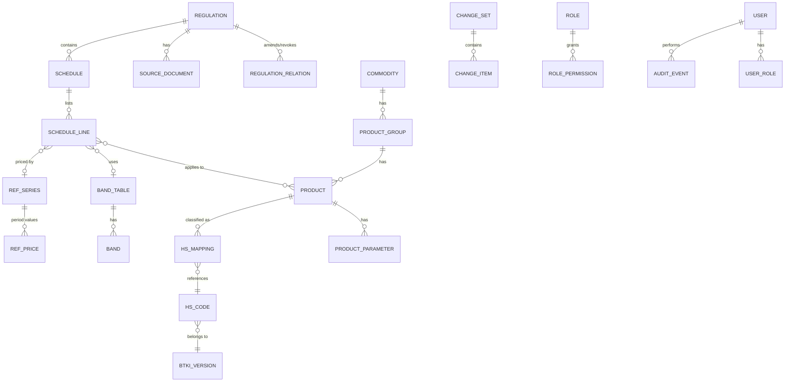

| Entity | Key fields |
|---|---|
| REGULATION | id, type, number, year, title_id, title_en, issuer, status, promulgated_on, effective_from, effective_to, official_url |
| SCHEDULE | id, regulation_id, charge_type (`BK`/`PE`), annex (Lampiran), commodity_id |
| SCHEDULE_LINE | id, schedule_id, kelompok, item_no, uraian (verbatim), basis_type, pct, usd_per_mt, band_table_id, band_values[], ref_series_id, effective_from/to |
| BAND_TABLE / BAND | id, ref_series_id, ordinal, lower_exclusive, upper_inclusive, label |
| PRODUCT | id (surrogate), commodity_id, group_id, item_no_as_printed, name_id, name_en, synonyms[], definition, notes[], annex_page, classification_regulation_id, effective_from/to, other_obligations_note |
| PRODUCT_PARAMETER | product_id, name, operator, value_text, unit, is_primary |
| HS_MAPPING | product_id, hs_code_id, is_ex, ex_description, effective_from/to |
| REF_SERIES / REF_PRICE | series code (CPO, COCOA, HE-<product>, FX-USDIDR), unit; period_from, period_to, value, source_regulation_id, source_document_id |
| CHANGE_SET | id, status, created_by, submitted_at, reviewed_by, decision, comment, effective_at, version_no |
| USER | id, email (unique, lower-case), full_name, department, status, mfa_enabled, failed_count, locked_until, last_login_at, access_expires_at |
| AUDIT_EVENT | id, ts_utc, actor_id, action, entity, entity_id, before, after, ip, user_agent, reason, hash_prev (hash chain) |

All business tables are **bitemporal-lite**: `effective_from/to` (legal validity) + immutable version rows (system history).

### 9.2 Calculation rules

The charge formulas per shipment come from PMK 214/2008 Article 4 (duty) and PMK 69/2025 Articles 4 and 8 (levy):

```latex
\begin{aligned}
BK_{specific} &= \text{USD/MT}_{band(ref)} \times Q \\
BK_{ad\,valorem} &= r_{BK} \times HE \times Q \\
PE_{palm} &= r_{PE} \times ref_{CPO} \times Q \\
PE_{fixed} &= \text{USD/MT} \times Q \\
PE_{cocoa} &= r_{PE}(ref_{cocoa}) \times HE \times Q \\
IDR &= USD \times KMK_{payment\ date}
\end{aligned}
```

| ID | Rule |
|---|---|
| BR-CAL-01 | Duty: the rate, band and Harga Ekspor in force on the date the export declaration (PEB) is registered at the customs office apply (PMK 214/2008 Art. 5(1)). The calculator's as-of date is that PEB date, default today (WIB). Levy: the rate follows the CPO reference price for the period; PMK 69/2025 does not state which date sets it, so the PEB date is used until BPDP confirms (OQ-03). |
| BR-CAL-02 | Band selection: first band where `ref_price ≤ upper_inclusive`; above the last edge → top band. Prototype edges: ≤680, 681–730 … 1,381–1,430, >1,430 (17 bands). |
| BR-CAL-03 | If the next period's Harga Ekspor is not yet set, the previous period's applies, labelled as such (PMK 214/2008 Art. 5(2)). A missing reference price or FX rate blocks the calculation with "value for <series> <period> not yet published". |
| BR-CAL-04 | Formulas above: Q = quantity in MT, ref = reference price, r = rate. HE = Harga Ekspor set per period by MK/BC decision (Customs for the Finance Minister, from the Trade Ministry's export price decree), never the invoice or FOB value. The cocoa levy uses the same HE (PMK 69/2025 Art. 8(4)). |
| BR-CAL-05 | Rounding: display 2 decimals for USD and 0 decimals for IDR; no intermediate rounding. |
| BR-CAL-06 | Distinguish **"Not listed"** (no schedule line) from **"Listed at 0"** (e.g. FFB levy USD 0). |
| BR-CAL-07 | If the product shares an HS code with a product carrying a different charge, show a warning naming the other product(s) and charge. |
| BR-CAL-08 | Every result displays: version number, regulation references, PEB date, payment date, and the disclaimer. |
| BR-CAL-09 | IDR uses the weekly KMK rate in force on the **payment date**, for duty (PMK 214/2008 Art. 5(3)) and levy (PMK 69/2025 Art. 9). Payment date is its own input, default the PEB date; the result names the KMK decree used. Exception: export goods with special characteristics use the PEB date (PMK 214/2008 Art. 5(4)). |
| BR-CAL-10 | Every rate, reference price, Harga Ekspor and FX value in a result links to its official source document (BR-SRC-01). |
| BR-CAL-11 | The payment date may be at most 30 days before the PEB date. Goods marked special-characteristic use the PEB date for FX (BR-CAL-09). |
| BR-CAL-12 | A what-if reference price replaces every reference price in force on the PEB date; the result is labelled SIMULATION and can never become evidence. A value that is not a positive number is ignored with a notice. |
| BR-CAT-01 | Catalogue categories, each product in exactly one: duty and levy, duty only, levy only, listed at 0, not listed. A charge that is listed but not computable for the date (e.g. reference price missing) counts as charged. The tiles always sum to the products shown. |
| BR-CAT-02 | Reads take a business date and a data version (default the latest). For a date after today, approved change sets scheduled to take effect by that date are applied on top of the published data; a calculation that relies on them cannot be saved. |

### 9.3 Other business rules (referenced above)

| ID | Rule |
|---|---|
| BR-IAM-01 | The first Super Admins are granted by an operator command after their first DWS Hub sign-in; the command is audited and ends the person's sessions. |
| BR-IAM-02 | Role-granting authority: User Admin → VIEWER/MAKER/CHECKER/AUDITOR; Super Admin → all. |
| BR-IAM-03 | Who may use ECR is decided in DWS Hub (application assignment); ECR keeps no email-domain allow-list. |
| BR-IAM-04 | Email is the unique login id, case-insensitive. |
| BR-IAM-05 | Local break-glass accounts only. Password: min 12 chars, max ≥ 64, all printable/Unicode allowed, checked against breached/common list, not containing email local part, last 5 not reusable. No forced periodic rotation (NIST SP 800-63B). |
| BR-IAM-06 | Lockout: 5 failures / 15 min → 15 min lock; 3 consecutive locks within 24 h → lock until admin unlock. |
| BR-IAM-07 | Admin-reset password is temporary and must be changed at next login. |
| BR-IAM-08 | Idle timeout 30 min (privileged 15 min); absolute 8 h; max 3 concurrent sessions per user. |
| BR-IAM-09 | Authentication and recovery responses never reveal whether an account exists or its status beyond "contact your administrator". |
| BR-IAM-10 | Rate limits: break-glass login 10/min/IP; reset 3/hour/account. |
| BR-IAM-12 | First DWS Hub sign-in creates the ECR account with the configured default role(s) (Viewer by default; empty means no access until a role is granted). A Hub identity whose email belongs to another ECR account is refused. |
| BR-IAM-13 | Privileged roles set up an ECR authenticator (TOTP, RFC 6238, ±1 step, each code used once) before any privileged function, and enter a code before sensitive actions (valid 5 min). Ten single-use recovery codes; 5 wrong codes in 15 min lock it for 15 min. Applies until DWS Hub reports MFA (OQ-12, T-01). |
| BR-IAM-11 | Dormancy 90 days → disabled; reactivation by User Admin. |
| BR-REG-01 | (type, number, year) unique. |
| BR-REG-02 | Amendment graph must be acyclic. |
| BR-PRD-01 | Every product must reference its classification regulation and have validity dates. |
| BR-PRD-02 | "As printed" item numbers may duplicate; surrogate key is the identity. |
| BR-PRD-03 | HS codes validated against the selected BTKI version; non-code text (e.g. "ex 4407 (all subheadings…)") must be expanded to explicit codes. |
| BR-PRD-04 | Shared tariff posts are computed, not manually entered. |
| BR-TRF-01 | A product may have at most one active BK line and one active PE line per date. |
| BR-TRF-02 | Band tables contiguous, non-overlapping, covering 0→∞. |
| BR-TRF-03 | Rates ≥ 0; % ≤ 100. |
| BR-TRF-04 | Band and %-of-reference bases must name their reference series. |
| BR-REF-01 | Reference-price periods within a series must not overlap. |
| BR-REF-02 | Change > ±30 % vs. previous period → warning requiring Maker acknowledgement. |
| BR-REF-03 | Harga Ekspor periods may be monthly or half-monthly (e.g. 15–30 Sep 2026); the previous period's value stays in force until a new decision is published. |
| BR-SRC-01 | Every published regulation, rate, reference price, Harga Ekspor and FX value has a source document from an allow-listed official domain (13.1), stored with SHA-256. News and consultancy pages may be attached only as secondary references. |
| BR-AUD-01 | Audit log is append-only and hash-chained; tampering detectable. |
| BR-AUD-02 | Retain audit log and published versions **10 years** (aligned with Indonesian tax-record retention; decided 28 Oct 2026 — OQ-06). |

---

## 10. Non-functional requirements

| Category | ID | Requirement |
|---|---|---|
| Security | NFR-SEC-01 | Conform to **OWASP ASVS 4.0 Level 2**; OWASP Top 10 mitigated; independent pen-test before go-live with no open Critical/High. |
| | NFR-SEC-02 | TLS 1.2+ (HSTS); cookies `Secure; HttpOnly; SameSite=Strict`; CSRF tokens on state-changing requests; strict CSP; no inline scripts. |
| | NFR-SEC-03 | Secrets in a vault/KMS; DB encryption at rest (AES-256); backups encrypted. |
| | NFR-SEC-04 | All tokens (session, CSRF, reset, recovery codes) ≥ 128-bit entropy, stored hashed; reset and recovery codes single-use. |
| | NFR-SEC-05 | File uploads virus-scanned, type-verified by content, stored outside web root. |
| | NFR-SEC-06 | Security events forwarded to SIEM (if available) within 5 min. |
| Privacy | NFR-PRV-01 | Comply with **UU 27/2022 (Perlindungan Data Pribadi)**: minimal personal data (name, email, department, IP logs), privacy notice at first sign-in, data-subject requests handled by Super Admin. |
| Performance | NFR-PRF-01 | Catalogue search & filter p95 ≤ 500 ms for 10,000 products; calculation p95 ≤ 300 ms; page LCP ≤ 2.5 s on 4G. |
| Availability | NFR-AVL-01 | 99.5 % monthly during 06:00–22:00 WIB business window; planned maintenance announced 48 h ahead. |
| Recoverability | NFR-REC-01 | RPO ≤ 24 h, RTO ≤ 4 h; ApsaraDB automated backups with point-in-time recovery; quarterly restore test. |
| Scalability | NFR-SCL-01 | 500 concurrent users; 50 k products; 10 years of versions. |
| Accessibility | NFR-ACC-01 | WCAG 2.1 AA: keyboard operable rows/sorting (`aria-sort`, `aria-expanded`), focus visible, contrast ≥ 4.5:1. |
| Responsiveness | NFR-RSP-01 | Usable from 360 px width; table switches to card list or horizontal scroll with sticky first column; sticky header must work. |
| Localisation | NFR-L10N-01 | EN/ID UI; dates `DD MMM YYYY`; numbers locale-aware; time zone WIB displayed, UTC stored. |
| Auditability | NFR-AUD-01 | Every published figure reproducible from version number + inputs. |
| Maintainability | NFR-MNT-01 | Automated tests ≥ 80 % on calculation & authorisation modules; calculation golden-file tests from Tax-team samples. |
| Observability | NFR-OBS-01 | Structured logs, health endpoint, metrics (latency, errors, login failures), alerting. |
| Browser support | NFR-BRW-01 | Latest 2 versions of Chrome, Edge, Firefox, Safari. |
| Security | NFR-SEC-07 | Reachable only from office IP ranges and the corporate VPN, enforced by Alibaba Cloud security groups and WAF; database in a private subnet with no public endpoint. |
| Hosting | NFR-HST-01 | Alibaba Cloud: FE server, BE server, ApsaraDB RDS for PostgreSQL 18; separate development, UAT and production environments; region chosen for data residency (OQ-13). |

---

## 11. User stories — positive & negative (per functionality)

Format: **P** = positive (happy path), **N** = negative (error, abuse or boundary path). Acceptance criteria (AC) use Given / When / Then. Each functionality maps to the FR IDs in §7.

### Functionality index

| Module | ID | Functionality | FR |
|---|---|---|---|
| IAM | F-01 | Super Admin bootstrap | FR-IAM-01 |
| IAM | F-02 | Account creation at first DWS Hub sign-in | FR-IAM-02 |
| IAM | F-03 | Identity conflicts at first sign-in | FR-IAM-03 |
| IAM | F-04 | Withdrawn — DWS Hub handles invitations and activation | — |
| IAM | F-05 | Login | FR-IAM-04, 07 |
| IAM | F-06 | MFA enrolment & challenge | FR-IAM-05 |
| IAM | F-07 | Forgot / reset password & MFA reset | FR-IAM-06 |
| IAM | F-08 | Profile, change password, own sessions | FR-IAM-12 |
| IAM | F-09 | Session timeout, step-up & logout | FR-IAM-08 |
| IAM | F-10 | User management | FR-IAM-09 |
| IAM | F-11 | Role & permission management (RBAC) | FR-IAM-10 |
| IAM | F-12 | Access review & dormant accounts | FR-IAM-11 |
| IAM | F-13 | Single sign-on through DWS Hub | FR-IAM-13 |
| IAM | F-14 | Network access restriction (office and VPN only) | FR-IAM-14 |
| Data | F-20 | Regulation register | FR-REG-01 |
| Data | F-21 | Source document repository | FR-REG-02 |
| Data | F-22 | Commodity & group management | FR-PRD-01 |
| Data | F-23 | Product master maintenance | FR-PRD-02 |
| Data | F-24 | HS code mapping (BTKI) & shared-HS detection | FR-PRD-03/04 |
| Data | F-25 | Export Duty (BK) schedule maintenance | FR-TRF-01/03 |
| Data | F-26 | Export Levy (PE) schedule maintenance | FR-TRF-02 |
| Data | F-27 | Reference price & FX management | FR-REF-01 |
| Data | F-28 | Bulk import (Excel) | FR-IMP-01 |
| Data | F-29 | Maker-checker approval & publishing | FR-WF-01 |
| Data | F-30 | Version history, diff & rollback | FR-WF-02 |
| Data | F-31 | Official source verification | FR-SRC-01…05 |
| Use | F-40 | Product catalogue (structured list) | FR-CAT-01 |
| Use | F-41 | Search | FR-CAT-02 |
| Use | F-42 | Filter & sort | FR-CAT-03/04 |
| Use | F-43 | Product detail | FR-CAT-05 |
| Use | F-44 | Charge calculator | FR-CAL-01/02/03 |
| Use | F-45 | As-of date (historical) lookup | FR-CAL-01 |
| Use | F-46 | KPI tiles | FR-CAT-06 |
| Use | F-47 | Export & permalink | FR-EXP-01/03 |
| Use | F-48 | Change notifications (R2) | FR-NTF-01 |
| Use | F-49 | Language switch | FR-UI-01 |
| Gov | F-50 | Audit trail | FR-AUD-01/02 |
| Gov | F-51 | Data-quality checks | FR-DQ-01 |
| Gov | F-52 | System configuration | FR-CFG-01 |
| Gov | F-53 | Read-only API (R2) | FR-API-01 |

---

### Module A — Identity & Access Management

Authentication mode: every user signs in through DWS Hub SSO (F-13), and ECR is reachable only from the office network and VPN (F-14). DWS Hub decides who may use ECR; ECR creates the account at first sign-in (F-02) and owns roles, sessions and audit. The password and reset criteria in F-05 and F-07 apply to local break-glass Super Admin accounts; the ECR authenticator (F-06) applies to everyone in a privileged role.

#### F-01 Super Admin bootstrap

**US-01-P1 (Positive)** — As the nominated platform owner, I want an operator to make me Super Admin after my first sign-in, so that the platform has an accountable administrator from day one.
* **AC1** Given I have signed in once through DWS Hub (account with the default role), when the operator runs `grant:role` with my email, role `SUPER_ADMIN` and a reason, then I hold the role, my sessions end and `ROLE_GRANTED_CLI` is audited with the operator's OS user.
* **AC2** At my next sign-in I must set up the ECR authenticator before any privileged function.
* **AC3** Two Super Admins are granted this way; from then on roles are managed in *Users* (SoD-4).

**US-01-N1 (Negative)** — As the security owner, I want the command to be unable to create accounts or touch inactive ones.
* **AC1** Given no ECR account exists for the email, the command exits with "The person must sign in through DWS Hub once first" and changes nothing.
* **AC2** Given the account is not `ACTIVE`, the command refuses; given the person already holds the role, it reports that and changes nothing.

---

#### F-02 Account creation at first DWS Hub sign-in

**US-02-P1 (Positive)** — As an employee given ECR in DWS Hub, I want my ECR account created when I first sign in, so that I can start without waiting for an ECR administrator.
* **AC1** Given my Hub identity is new to ECR, when I sign in, then an `ACTIVE` account is created with my Hub name and email and the default role (Viewer), and `USER_PROVISIONED` is audited.
* **AC2** Given I sign in again later, my name and email are refreshed from DWS Hub; my roles stay as set in ECR.

**US-02-P2 (Positive)** — As a User Admin, I want people to appear in *Users* after their first sign-in, so that I can give them the roles their job needs.
* **AC1** The users list shows the new account with role Viewer; role changes follow L2-1.3.

**US-02-N1 (Negative)** — As the security owner, I want the default role to be configurable, so that ECR grants nothing if DWS Hub lets anyone in.
* **AC1** Given the default role list is empty, a new account gets no roles and sees "You don't have access" until a role is granted (OQ-14).

---

#### F-03 Identity conflicts at first sign-in

**US-03-N1 (Negative)** — As the security owner, I don't want a new Hub identity to take over an existing ECR account.
* **AC1** Given a new Hub `sub` whose email already belongs to another ECR account, sign-in is refused with "This email already belongs to another ECR account. Contact your administrator." and `LOGIN_IDENTITY_CONFLICT` is audited.
* **AC2** Given a Hub token without an email, sign-in is refused with "DWS Hub did not share an email for your account".
* **AC3** Given a deactivated ECR account, sign-in is refused even with a valid Hub sign-in.

---

#### F-04 Withdrawn

Invitations, access requests and account activation are handled by DWS Hub; ECR has no invitation or access-request flow (decided 29 Oct 2026). Activation is replaced by F-02.

---

#### F-05 Login

**US-05-P1 (Positive)** — As an active user, I want to sign in with my email and password (plus MFA when required), so that I can access the functions for my role.
* **AC1** Given valid credentials and MFA code, I am signed in, a new session id is issued, and I am redirected to the page I originally requested (same-origin only) or my home page.
* **AC2** `LOGIN_SUCCESS` is audited with IP and user agent; *last login* is shown on my profile.

**US-05-N1 (Negative)** — As the security owner, I want wrong credentials to give no hints.
* **AC1** Given a wrong password **or** an unknown email, the message is "Email or password is incorrect" with an indistinguishable response time.
* **AC2** `LOGIN_FAILED` is audited (never the password).

**US-05-N2 (Negative)** — As the security owner, I want brute-force attempts stopped.
* **AC1** Given 5 failed attempts within 15 minutes, the account is `LOCKED` for 15 minutes and the user receives an email "Your account was temporarily locked".
* **AC2** Given 3 locks within 24 h, the account stays locked until a User Admin unlocks it.
* **AC3** Given more than 10 login attempts per minute from one IP, further attempts get HTTP 429.

**US-05-N3 (Negative)** — As the security owner, I want deactivated, expired or dormant users to be unable to sign in.
* **AC1** When such a user submits correct credentials, they see "Your account is not active. Contact your administrator." and no session is created.

**US-05-N4 (Negative)** — As the security owner, I want to prevent open redirects after login.
* **AC1** Given a `returnUrl` pointing to another domain, the user is redirected to their home page instead.

---

#### F-06 MFA enrolment & challenge

**US-06-P1 (Positive)** — As a Maker, I want to protect my account with an authenticator app, so that a stolen password is not enough to change regulatory data.
* **AC1** When enrolling, I scan a QR code (secret also shown as text), enter a valid 6-digit code, and receive 10 one-time recovery codes that I must confirm I've saved.
* **AC2** At my first privileged sign-in I must set it up before any privileged function; before a sensitive action older than 5 minutes I'm asked for a code, and a valid code within ±30 s lets the action through.

**US-06-P2 (Positive)** — As a user who lost my phone, I want to sign in with a recovery code, so that I'm not locked out.
* **AC1** A valid unused recovery code confirms the action, is marked used, and the remaining code count is shown; a User Admin can reset my authenticator so I set it up again.

**US-06-N1 (Negative)** — As the security owner, I want MFA codes to resist guessing and replay.
* **AC1** Given 5 wrong codes within 15 minutes, the authenticator is locked for 15 minutes; failed attempts are counted even when the request fails.
* **AC2** Given a code already used within its time window, it is rejected.

**US-06-N2 (Negative)** — As the security owner, I want privileged users to be unable to disable MFA.
* **AC1** Given a privileged role, the *Disable MFA* option is not available and the API returns 403; only *Re-enrol* is offered.

---

#### F-07 Forgot / reset password & MFA reset

**US-07-P1 (Positive)** — As a user who forgot my password, I want to reset it by email, so that I can regain access without calling IT.
* **AC1** When I enter my email, I see "If an account exists, we've sent a reset link."
* **AC2** The link works once within 30 minutes; after setting a new compliant password (and passing MFA if enrolled) all my sessions are revoked and I receive a "password changed" email.

**US-07-P2 (Positive)** — As a User Admin, I want to reset a user's MFA after verifying their identity, so that they can re-enrol.
* **AC1** With step-up authentication and a mandatory reason, MFA is cleared; at next login the user must re-enrol; `MFA_RESET` is audited and the user is emailed.

**US-07-N1 (Negative)** — As the security owner, I want password reset not to reveal accounts or be abusable.
* **AC1** Given an unknown email, the UI message is identical and no email is sent.
* **AC2** Given more than 3 reset requests per hour for an account, further requests are silently dropped (same UI message).
* **AC3** Given an expired or used reset link, the page says "link invalid or expired" and offers to request a new one.

**US-07-N2 (Negative)** — As the security owner, I don't want password reset to bypass MFA.
* **AC1** Given MFA is enrolled, the reset flow requires a valid MFA or recovery code before the new password is accepted.

**US-07-N3 (Negative)** — As the security owner, I want a User Admin to be unable to reset MFA for a Super Admin or for themselves.
* **AC1** The action is hidden and the API returns 403; only another Super Admin can reset a Super Admin's MFA.

---

#### F-08 Profile, change password & own sessions

**US-08-P1 (Positive)** — As any signed-in user, I want to see my profile, change my password and see my active sessions, so that I can manage my own security.
* **AC1** Profile shows name, email, department, roles, MFA status, last login and active sessions (device, IP, last activity).
* **AC2** Changing password requires the current password; all other sessions are revoked.
* **AC3** *Sign out other sessions* revokes all sessions except the current one.

**US-08-N1 (Negative)** — As the security owner, I want users unable to change their own roles, email or status.
* **AC1** These fields are read-only in the UI and the API rejects such changes with 403.
* **AC2** Given a wrong current password on change, I see "Current password is incorrect" and the attempt counts toward lockout.

---

#### F-09 Session timeout, step-up & logout

**US-09-P1 (Positive)** — As a Checker, I want to be warned before my session times out, so that I don't lose an approval in progress.
* **AC1** 2 minutes before idle timeout, a dialog with countdown offers *Stay signed in*; clicking it extends the idle timer (not the absolute limit).

**US-09-P2 (Positive)** — As a user, I want *Sign out* to end my session completely, so that shared computers are safe.
* **AC1** On sign-out the server session is destroyed, the cookie cleared, and the back button cannot show protected pages (no-store cache headers).

**US-09-N1 (Negative)** — As the security owner, I want expired sessions to be unusable.
* **AC1** Given idle 15 min (privileged) / 30 min (Viewer) or absolute 8 h has elapsed, any request returns 401 and the UI redirects to login preserving the target URL; unsaved draft form data is kept locally in the browser and offered for restore.

**US-09-N2 (Negative)** — As the security owner, I want sensitive actions protected even in a live session.
* **AC1** Given my last code was more than 5 minutes ago, when I click *Approve*, *Reject*, *Cancel schedule*, *Rollback*, *Save roles*, *Deactivate*, *Reset authenticator* or *Save configuration*, then I must enter a code from my ECR authenticator (or a recovery code); after it is accepted the action runs; cancelling aborts it.

---

#### F-10 User management

**US-10-P1 (Positive)** — As a User Admin, I want to find users and change their roles, status and access expiry, so that access matches current job needs.
* **AC1** The users list supports search (name/email), filters (role, status, MFA, last-login range), sorting and CSV export.
* **AC2** Role changes require step-up auth, take effect on the user's next request, are emailed to the user and audited with before/after values.

**US-10-P2 (Positive)** — As a User Admin, I want to deactivate a leaver immediately, so that they lose access the same day.
* **AC1** On *Deactivate* (reason required) all sessions are revoked instantly; any of their Draft/Submitted change sets are flagged for reassignment.

**US-10-N1 (Negative)** — As the security owner, I want SoD enforced in user management.
* **AC1** A User Admin cannot edit their own roles/status (SoD-3) — controls disabled and API returns 403.
* **AC2** A User Admin cannot modify `USER_ADMIN` or `SUPER_ADMIN` accounts.
* **AC3** Deactivating or demoting a Super Admin when only two active Super Admins exist is blocked with "At least two active Super Admins are required" (SoD-4).

**US-10-N2 (Negative)** — As a User Admin, I don't want to lose evidence by deleting users.
* **AC1** There is no hard delete for users with any audit history — only deactivate. Personal-data erasure requests are handled by a Super Admin via pseudonymisation that keeps audit integrity.

---

#### F-11 Role & permission management (RBAC)

**US-11-P1 (Positive)** — As a Super Admin, I want to view the permission matrix and create a custom role (e.g. "Finance Viewer – export only"), so that access fits the organisation.
* **AC1** Built-in roles are shown read-only; custom roles are composed from permissions; changes require step-up auth and are audited.
* **AC2** The UI shows how many users hold each role.

**US-11-N1 (Negative)** — As the security owner, I want role configuration to be safe.
* **AC1** Built-in roles cannot be deleted, and SoD-conflicting permissions (e.g. `change_set.create` + `change_set.approve`) cannot be combined in one custom role — save is blocked with an explanation.
* **AC2** A role assigned to users cannot be deleted until those users are reassigned.
* **AC3** Any non-Super-Admin calling role APIs receives 403.

**US-11-N2 (Negative)** — As the security owner, I want a Viewer to be unable to reach admin functions by URL.
* **AC1** Given a Viewer navigates to `/admin/users` or calls admin APIs, they get 403 (UI: "You don't have access to this page") and the attempt is logged.

---

#### F-12 Access review & dormant accounts

**US-12-P1 (Positive)** — As a User Admin, I want a quarterly access-review campaign, so that I can attest who should keep which role.
* **AC1** The campaign lists each user/role with last login; I can *Keep* or *Revoke*; completion produces a signed report downloadable by the Auditor.

**US-12-N1 (Negative)** — As the security owner, I want inactive accounts disabled automatically and reviews not ignored.
* **AC1** Given no login for 90 days, the account becomes `DORMANT_DISABLED`; at day 80 the user is warned by email.
* **AC2** Given a review item not actioned in 14 days, it escalates to Super Admins; Super Admin accounts are reviewed by another Super Admin.

---

#### F-13 Single sign-on through DWS Hub

**US-13-P1 (Positive)** — As an employee, I want to sign in to ECR with my DWS Hub account, so that I use one corporate identity and don't manage another password.
* **AC1** *Sign in with DWS Hub* redirects to DWS Hub, returns a verified identity, and selects the ECR account linked to the Hub `sub`; on a first sign-in the account is created (F-02). Roles always come from ECR.
* **AC2** DWS Hub does not yet report MFA, so users in privileged roles also enter a one-time code from an authenticator app enrolled in ECR at their first privileged sign-in and for step-up; once the Hub sends `auth_time` and `amr` claims, ECR relies on them instead (OQ-12, T-01).
* **AC3** Signing out of ECR ends the ECR session; DWS Hub has no logout endpoint yet (T-05), so the page says the Hub session is still active and links to DWS Hub.

**US-13-N1 (Negative)** — As the security owner, I don't want SSO alone to grant access.
* **AC1** DWS Hub decides who may sign in to ECR; ECR gives a new account only the default role, and privileged roles only through L2-1.3.
* **AC2** A deactivated, expired or dormant ECR account is refused even with a valid DWS Hub sign-in.
* **AC3** Tampered, expired or wrong-audience SSO responses are rejected and logged.
* **AC4** While DWS Hub is unavailable, only local break-glass Super Admins can sign in, and each use alerts the other Super Admins.

---

#### F-14 Network access restriction (office and VPN only)

**US-14-P1 (Positive)** — As IT Security, I want ECR reachable only from the office network and the corporate VPN, so that regulatory data and admin functions are never exposed to the internet.
* **AC1** Requests from configured office IP ranges and the VPN address pool reach the sign-in page; the allow-list lives in Alibaba Cloud security groups and WAF and is mirrored in ECR configuration (F-52).

**US-14-N1 (Negative)** — As the security owner, I want any other origin blocked before it reaches the application.
* **AC1** Requests from outside the allow-list are refused at the network edge and never reach the FE or BE servers; if one gets through, ECR rejects it and logs the source IP.
* **AC2** The only pages without sign-in are sign-in, sign-in errors and signed-out, all reachable only inside the allow-list.

---

### Module B — Regulation & master data administration

#### F-20 Regulation register

**US-20-P1 (Positive)** — As a Maker, I want to register a new PMK amending the levy schedule, so that users can see which law governs each levy.
* **AC1** I can enter type, number, year, titles (ID/EN), issuer, status, promulgation/effective/end dates, official URL, and link "amends PMK 69/2025".
* **AC2** The register list shows each regulation's status badge and amendment chain (timeline view).

**US-20-N1 (Negative)** — As a Maker, I want the system to block inconsistent regulation records.
* **AC1** Given (type, number, year) already exists, save is blocked: "Regulation already registered" with a link.
* **AC2** Given an effective date earlier than the promulgation date, a warning requires confirmation; given an end date earlier than the effective date, save is blocked.
* **AC3** Given an amendment link that would create a cycle, save is blocked.

**US-20-N2 (Negative)** — As a Viewer, I must not see unpublished regulations.
* **AC1** Draft regulations are excluded from all Viewer lists, searches and APIs.

---

#### F-21 Source document repository

**US-21-P1 (Positive)** — As a Maker, I want to attach the official PDF of a regulation and its annexes, so that Checkers and users can verify the source.
* **AC1** Upload PDF ≤ 25 MB; the system stores SHA-256, uploader and timestamp; Viewers can download published documents.

**US-21-N1 (Negative)** — As the security owner, I want uploads to be safe and immutable once published.
* **AC1** Given a file that fails virus scan, is not a real PDF (content sniffing) or exceeds 25 MB, upload is rejected with the reason.
* **AC2** Published documents cannot be replaced; a new version must be uploaded and linked, preserving the old one.

---

#### F-22 Commodity & group management

**US-22-P1 (Positive)** — As a Maker, I want to add a new commodity (e.g. coconut) and its classification groups, so that new levy scopes can be modelled.
* **AC1** A commodity has code, names (ID/EN), default reference series and unit; groups have an ordinal for display order.

**US-22-N1 (Negative)** — As a Maker, I must not orphan products.
* **AC1** Given a commodity/group has products, delete is blocked; only *Deactivate (end-date)* is allowed.
* **AC2** Given a duplicate commodity code, save is blocked.

---

#### F-23 Product master maintenance

**US-23-P1 (Positive)** — As a Maker, I want to create a product with its definition and technical identification parameters, so that users can identify it correctly at export.
* **AC1** I can enter names (ID/EN), synonyms, "as printed" item no., annex page, definition, parameters (name, operator, value, unit, primary flag), notes, other-obligations note, classification regulation and validity.
* **AC2** The primary parameter is shown as "Key spec" in the catalogue.

**US-23-P2 (Positive)** — As a Maker, I want to record a product whose source item number is duplicated, so that I mirror the regulation exactly.
* **AC1** Given another product in the same group already has item no. "10", I can save with a DQ-04 info flag; both remain distinct by surrogate id.

**US-23-N1 (Negative)** — As a Checker, I want incomplete products blocked from submission.
* **AC1** Given no classification regulation, no validity start or no HS mapping, *Submit* is blocked with the list of missing fields.
* **AC2** Given a palm product without definition or parameters, submit shows a DQ-05 warning that must be acknowledged.

**US-23-N2 (Negative)** — As a Maker, I must not edit published data directly or overwrite a colleague's draft.
* **AC1** Editing a published product creates a draft copy in a change set; the published record stays unchanged until approval.
* **AC2** Given another Maker has the same product in an open change set, I'm warned "Product is being edited in change set #123 by <name>" and can only view.

---

#### F-24 HS code mapping & shared-HS detection

**US-24-P1 (Positive)** — As a Maker, I want to map a product to 8-digit HS codes, including partial "ex" codes, so that tariff positions are precise.
* **AC1** Input `15111000`, `1511 10 00` or `1511.10.00` normalises to `1511.10.00` and is validated against the selected BTKI version.
* **AC2** Marking a code as `ex` requires a qualifying description.
* **AC3** The system shows other products sharing that code and their charges.

**US-24-N1 (Negative)** — As a Checker, I want invalid HS input rejected.
* **AC1** Given a code not in the BTKI version, wrong length, or free text (e.g. "ex 4407 (all subheadings…)"), save is blocked with "Enter explicit 8-digit HS codes".
* **AC2** Given the same HS code added twice to one product, the duplicate is rejected.

---

#### F-25 Export Duty (BK) schedule maintenance

**US-25-P1 (Positive)** — As a Maker, I want to enter a palm BK line as 17 USD/MT amounts against the CPO band table, so that duty can be calculated for any reference price.
* **AC1** I pick the regulation, annex (Lampiran), *Kelompok*, item no., paste the verbatim *uraian*, select basis `BAND_USD_PER_MT` and the band table, and enter one amount per band.
* **AC2** An impact preview shows old vs. new duty for each linked product at the current CPO reference price.

**US-25-P2 (Positive)** — As a Maker, I want to enter ad-valorem lines (e.g. wood 5 %, hides 25 %) and cocoa banded-% lines, so that non-palm goods are covered.
* **AC1** `AD_VALOREM_PCT` requires a % and the Harga Ekspor series; `BAND_PCT` requires the cocoa band table and a % per band.

**US-25-N1 (Negative)** — As a Checker, I want rate errors caught before review.
* **AC1** Given a band table with gaps/overlaps or not ending at ∞, submission is blocked (BR-TRF-02).
* **AC2** Given a negative amount, a % > 100, or fewer amounts than bands, save is blocked.
* **AC3** Given amounts that decrease as the reference price rises, a warning must be acknowledged.

**US-25-N2 (Negative)** — As a Checker, I want a product never to have two active BK lines on the same date.
* **AC1** Given a product already linked to an active BK line overlapping the validity period, save is blocked and the conflicting line is shown.

---

#### F-26 Export Levy (PE) schedule maintenance

**US-26-P1 (Positive)** — As a Maker, I want to enter levy lines as a % of the CPO reference price or as fixed USD/MT, so that the levy matches the PMK.
* **AC1** `PCT_OF_REF_PRICE` requires a % and reference series; `FIXED_USD_PER_MT` requires an amount; `ZERO_LISTED` records an explicit USD 0 line (e.g. Fresh Fruit Bunch).

**US-26-N1 (Negative)** — As a Checker, I want invalid levy lines blocked.
* **AC1** Given % ≤ 0 or > 100 for `PCT_OF_REF_PRICE`, or no reference series, save is blocked.
* **AC2** Given overlapping active PE lines for a product, save is blocked.
* **AC3** Given a levy line not linked to any product, a DQ-08 warning appears on submit.

---

#### F-27 Reference price & FX management

**US-27-P1 (Positive)** — As a Maker, I want to record the monthly CPO reference price from the Minister of Trade decree, so that duty and levy for that month are correct.
* **AC1** I enter series `CPO`, period (e.g. 1–30 Nov 2026), value (USD/MT), source regulation and document; once published, calculations for dates in that period use it.
* **AC2** The catalogue header shows "CPO reference price: USD x (period, source)".

**US-27-P2 (Positive)** — As a Maker, I want to record the weekly KMK USD/IDR rate, so that IDR amounts are correct.
* **AC1** Series `FX-USDIDR` accepts a weekly period, rate and KMK reference; the calculator uses the rate in force on the payment date.

**US-27-N1 (Negative)** — As a Checker, I want price errors caught.
* **AC1** Given a period overlapping an existing published period for the same series, save is blocked.
* **AC2** Given a value deviating more than ±30 % from the previous period, a warning must be acknowledged with a comment.
* **AC3** Given a value ≤ 0, save is blocked.

**US-27-N2 (Negative)** — As a Viewer, I want to be told when the current month's reference price is missing rather than see a wrong number.
* **AC1** Given no published CPO price covers today, the catalogue shows a warning banner "Reference price for <month> not yet published — showing last available (<month>)", and the calculator for today's date is blocked (BR-CAL-03) unless a what-if override is used.

---

#### F-28 Bulk import (Excel)

**US-28-P1 (Positive)** — As a Maker, I want to import a full annex from an Excel template, so that a new PMK with 100+ lines can be loaded in minutes.
* **AC1** Upload → dry-run report (rows OK / warnings / errors) → *Create change set* creates all rows as Draft with an import id.
* **AC2** The initial migration of the prototype's 122 palm rows uses this same function.

**US-28-N1 (Negative)** — As a Maker, I want the import to be all-or-nothing on errors and safe against malicious files.
* **AC1** Given any row with an error (missing mandatory field, invalid HS, wrong band count), no data is saved and the error report lists row, column and message, downloadable as Excel.
* **AC2** Given an outdated template version, the upload is rejected with a link to the current template.
* **AC3** Given a text cell starting with `=`, `+`, `-` or `@`, it is rejected (formula injection).
* **AC4** Given a file > 10 MB or not `.xlsx`, the upload is rejected.

---

#### F-29 Maker-checker approval & publishing

**US-29-P1 (Positive)** — As a Maker, I want to bundle related changes (new regulation + changed lines + new reference price) into one change set and submit it, so that they publish together consistently.
* **AC1** *Submit* runs validation; on pass, status becomes `SUBMITTED` and Checkers are notified.
* **AC2** I can withdraw a submitted change set before review starts, and discard a draft or rejected one (status `CANCELLED`; its records are released, nothing is deleted).

**US-29-P2 (Positive)** — As a Checker, I want to review a field-level diff with impact preview and approve with an effective date, so that changes go live exactly when the law takes effect.
* **AC1** The diff highlights old/new values; the impact table shows the charge change per product at the current reference price.
* **AC2** On approve (step-up auth), if the effective date ≤ now the status becomes `PUBLISHED`; otherwise `SCHEDULED` and it auto-publishes at 00:00 WIB on that date.
* **AC3** A change bulletin listing all changes is generated.

**US-29-N1 (Negative)** — As the security owner, I want four-eyes enforced.
* **AC1** Given I created or edited any item in the change set, *Approve* is disabled and the API returns 403 (SoD-1).
* **AC2** Given a change set fails validation, it cannot move to `IN_REVIEW`.

**US-29-N2 (Negative)** — As a Checker, I want to reject with reasons, so that the Maker can fix it.
* **AC1** *Reject* requires a comment (overall and/or per item); status becomes `REJECTED`; the Maker is notified and can rework it into Draft.

**US-29-N3 (Negative)** — As a Checker, I want to stop a scheduled change if the regulation is postponed.
* **AC1** Given status `SCHEDULED` and the effective date not reached, *Cancel schedule* (reason required) returns it to Draft. After publishing, only rollback is possible.

**US-29-N4 (Negative)** — As a Checker, I want conflicting concurrent changes detected.
* **AC1** Given another change set touching the same records was published after this one was created, approval is blocked with "Change set is stale — rebase required", and the Maker must refresh it.

---

#### F-30 Version history, diff & rollback

**US-30-P1 (Positive)** — As a Tax Specialist, I want to see the history of a product's charges, so that I can explain differences between shipments.
* **AC1** Product detail → *History* lists versions with effective dates, change set, approver and diff.

**US-30-P2 (Positive)** — As a Checker, I want to roll back an erroneous publication, so that wrong rates stop being used quickly.
* **AC1** *Rollback to version N* creates a change set restoring version N's values that must be approved by a different Checker; after publishing, the erroneous version stays visible in history marked `ROLLED_BACK`.

**US-30-N1 (Negative)** — As an Auditor, I want history to be immutable.
* **AC1** No role (including Super Admin) can edit or delete a published version or its audit records; API attempts return 403/405 and are logged.
* **AC2** A rollback cannot be approved by the Checker who initiated it.

---

#### F-31 Official source verification

**US-31-P1 (Positive)** — As a Checker, I want every value in a change set linked to its official source document, so that I can verify it against the gazette before approving.
* **AC1** Each regulation, schedule line, reference price, Harga Ekspor and FX value shows its source (publisher, number, date, URL) and SHA-256, and the diff view opens the document beside the value.
* **AC2** A scheduled check against the BPK regulation database marks a registered regulation amended or revoked and creates an intake task for Makers.

**US-31-N1 (Negative)** — As the security owner, I want unsourced or altered sources impossible to publish.
* **AC1** A change set with any value lacking an official source document cannot be submitted; the error lists those values.
* **AC2** A URL outside the allow-listed official domains (e.g. a news site) is rejected as a source of record and may only be attached as a secondary reference.
* **AC3** If a re-downloaded source file's SHA-256 differs from the stored one, the record is flagged for review and Checkers are alerted.

---

### Module C — Inquiry & calculation

#### F-40 Product catalogue (structured list)

**US-40-P1 (Positive)** — As an Export Commercial Officer, I want a structured list of all export products subject to duty and/or levy, so that I can see charges at a glance.
* **AC1** The list shows product, commodity/group (+ item no. as printed), HS code(s), key spec, BK, PE, total (per MT, USD), and badges (draft classification, shared HS, listed-at-zero vs. not listed).
* **AC2** Default order: commodity (Palm first, then others alphabetically), group, item no.
* **AC3** The header shows data version, as-of date and the reference price(s) used.
* **AC4** Pagination or virtual scrolling handles ≥ 10,000 rows; the sticky header works; the page is usable at 360 px width.

**US-40-N1 (Negative)** — As a user, I want values of different units never mixed.
* **AC1** Ad-valorem duties are shown as "% of HE" in the BK column and converted to USD/MT only when Harga Ekspor for the period is available (labelled); otherwise the total shows "n/a – needs HE" instead of a misleading number.

**US-40-N2 (Negative)** — As a user, I want a clear empty state.
* **AC1** Given no results, the list shows "No products match these filters" with a *Clear filters* button.

---

#### F-41 Search

**US-41-P1 (Positive)** — As a Logistics Officer, I want to search by product name (English or Bahasa), synonym, HS code in any format, or spec keyword, so that I quickly find the right product.
* **AC1** `glycerine`, `gliserin`, `15200010`, `1520.00.10`, `RBD` and `split` all return relevant products; matched text is highlighted.
* **AC2** Search is case- and diacritic-insensitive and also covers schedule *uraian* text.

**US-41-N1 (Negative)** — As the security owner, I want search to be safe and resilient.
* **AC1** Given input with HTML/script or SQL meta-characters, it is treated as literal text and rendered escaped.
* **AC2** Given input longer than 200 characters, it is truncated with a notice.
* **AC3** Given no match, "Did you mean…" suggestions are shown when a close match exists.

---

#### F-42 Filter & sort

**US-42-P1 (Positive)** — As a Tax Specialist, I want to filter by commodity, group, charge status (both / BK only / PE only / listed-at-zero / not listed), shared HS and regulation, so that I can focus on risk positions.
* **AC1** Filters are multi-select with result counts; active filters appear as removable chips; *Clear all* resets.
* **AC2** Sorting by any column toggles asc/desc, exposes `aria-sort`, and is keyboard operable.

**US-42-N1 (Negative)** — As a user, I want sorting by charge to be meaningful.
* **AC1** Given a mix of % ad-valorem and USD/MT rows, sorting by BK orders USD/MT rows numerically and groups % rows separately (labelled), never treating them as zero or -1.

---

#### F-43 Product detail

**US-43-P1 (Positive)** — As a Tax Specialist, I want a product page with definition, technical parameters, HS mappings, legal references and band strip, so that I can justify the classification and charges.
* **AC1** BK & PE lines show regulation number, Lampiran, *Kelompok*, item no. and the full verbatim *uraian* (never truncated mid-text; "Show more" for long text).
* **AC2** The band strip highlights the band for the current reference price.
* **AC3** The shared-HS box lists other products on the same code with their charges in plain words (e.g. "levy 10 % of CPO reference price"), not internal codes.
* **AC4** Links to source documents and version history are shown.

**US-43-N1 (Negative)** — As a user, I want to know when a classification is unofficial or a product does not exist.
* **AC1** Given the classification regulation status is `DRAFT_RANCANGAN`, a prominent badge says "Classification based on a draft regulation — subject to change".
* **AC2** Given a URL for a non-existent or unpublished product, a 404 page with a search box is shown.

---

#### F-44 Charge calculator

**US-44-P1 (Positive)** — As a Finance Officer, I want to calculate BK and PE for a product, quantity and date in USD and IDR, so that I can accrue export charges accurately.
* **AC1** Inputs: product (searchable), PEB date as the as-of date (default today WIB), payment date for the FX rate (default the PEB date), quantity in MT (default 1, up to 3 decimals).
* **AC2** Output: reference price & period, band, BK per MT & total, PE per MT & total, grand total USD, FX rate & date, IDR total, regulation references, version number.
* **AC3** Results match the Tax-team golden test set 100 %.

**US-44-P2 (Positive)** — As a Commercial Officer, I want a what-if with my own reference price, so that I can price forward contracts.
* **AC1** The override field shows a **SIMULATION** banner; results cannot be exported as official evidence.

**US-44-P3 (Positive)** — As a Finance Officer, I want to calculate a multi-product shipment in one go.
* **AC1** I can add up to 50 lines; each line shows a subtotal, plus a grand total; the result is exportable.

**US-44-N1 (Negative)** — As a user, I want invalid inputs rejected clearly.
* **AC1** Given quantity ≤ 0, non-numeric or > 1,000,000 MT, the field shows an inline error and no calculation runs.
* **AC2** Given a reference-price override < 0 or empty, it is ignored with a message.

**US-44-N2 (Negative)** — As a user, I want no silent wrong answers.
* **AC1** Given the reference price or FX rate is missing, the result area names the missing value and shows no total; a missing next-period Harga Ekspor falls back to the previous period, labelled as such (BR-CAL-03).
* **AC2** Given the product is not listed in a schedule, the line reads "Not subject to BK" / "Not subject to PE", distinct from "Listed at USD 0".

---

#### F-45 As-of date (historical) lookup

**US-45-P1 (Positive)** — As a Tax Specialist under audit, I want to view the catalogue and calculate charges as of a past PEB date, so that I can prove which rates applied.
* **AC1** Setting the as-of date re-renders catalogue, detail and calculator using the version, rates and reference prices in effect on that date; a banner shows "Viewing as of DD MMM YYYY (version N)".
* **AC2** Permalinks and exports include the as-of date.

**US-45-N1 (Negative)** — As a user, I want clear limits on historical and future data.
* **AC1** Given a date before the earliest loaded data, the message "No data loaded before <date>" is shown.
* **AC2** Given a future date, only `SCHEDULED` versions are considered and the banner says "Future date — scheduled changes applied; reference price not yet known" where applicable.

---

#### F-46 KPI tiles

**US-46-P1 (Positive)** — As a manager, I want summary tiles that add up to the total, so that I trust the numbers.
* **AC1** Tiles: products shown = BK+PE + BK only + PE only + listed-at-zero + not listed; plus shared-HS count, reference price and band. Clicking a tile applies the matching filter.

**US-46-N1 (Negative)** — As a manager, I want tiles never to contradict the list.
* **AC1** An automated test asserts that the category tiles sum to the products-shown tile for every filter combination in the test suite.

---

#### F-47 Export & permalink

**US-47-P1 (Positive)** — As a Tax Specialist, I want to export the filtered list or a calculation to Excel, so that I can attach it to my working papers.
* **AC1** XLSX/CSV, and the PDF/A evidence pack for calculations, include all visible columns plus HS codes, legal references, version number, as-of date, reference prices, export timestamp, exporting user and disclaimer.
* **AC2** *Copy link* produces a URL reproducing filters, sort, as-of date and calculator inputs.

**US-47-N1 (Negative)** — As the security owner, I want exports controlled and safe.
* **AC1** Roles without the `export` permission see no export button; the API returns 403.
* **AC2** Text cells beginning with `=`, `+`, `-` or `@` are prefixed with `'` to prevent formula injection.
* **AC3** Exports > 50,000 rows are generated asynchronously and emailed as a link valid 24 h to the requesting user only.
* **AC4** Permalinks never contain personal data or session tokens.

---

#### F-48 Change notifications (Release 2)

**US-48-P1 (Positive)** — As a Commercial Officer, I want to subscribe to "Palm – Group IV" changes, so that I'm told when rates change.
* **AC1** When a publication affects my subscribed scope, I receive an in-app and email notice with the change-bulletin link.

**US-48-N1 (Negative)** — As a user, I don't want notification spam or leaks.
* **AC1** Multiple changes in one change set produce one notification; users can unsubscribe in one click; deactivated users receive nothing.
* **AC2** Notification emails contain no draft data — only published changes.

---

#### F-49 Language switch

**US-49-P1 (Positive)** — As a user, I want the interface in English or Bahasa Indonesia, so that I work in my preferred language.
* **AC1** A header toggle switches language and is remembered in my profile; product names show both languages where available; legal *uraian* is always shown in the original Bahasa.

**US-49-N1 (Negative)** — As a user, I want a sensible fallback.
* **AC1** Given a translation is missing for a label or product name, the other language is shown rather than a blank or a key.

---

### Module D — Governance

#### F-50 Audit trail

**US-50-P1 (Positive)** — As an Auditor, I want to search the audit log by user, action, entity and date, so that I can investigate any change or access event.
* **AC1** Each event shows timestamp (WIB), actor, action, entity, before/after values, IP, user agent and reason; the log is exportable to CSV with a hash-chain verification status.

**US-50-N1 (Negative)** — As the security owner, I want the audit log tamper-evident and complete.
* **AC1** No UI or API exists to edit/delete audit events; the application's DB role has insert-only rights on the audit table.
* **AC2** A nightly job verifies the hash chain; a break raises a critical alert to Super Admins.
* **AC3** Passwords, MFA secrets, tokens and recovery codes are never written to logs.
* **AC4** If the audit write fails, the originating business transaction is rolled back (fail-closed).

---

#### F-51 Data-quality checks

**US-51-P1 (Positive)** — As a Checker, I want automated DQ findings on each change set and a nightly DQ dashboard, so that data issues are visible before users see them.
* **AC1** Findings list rule id, severity, entity, message and link; errors block submission; warnings require acknowledgement.

**US-51-N1 (Negative)** — As a Checker, I want DQ rules impossible to bypass.
* **AC1** Given an Error-level finding, no role can approve the change set; API approval returns 422 with the findings.

---

#### F-52 System configuration

**US-52-P1 (Positive)** — As a Super Admin, I want to configure timeouts, the default role at first sign-in, the office and VPN IP allow-list, and disclaimer text, so that the platform fits company policy.
* **AC1** Each change requires step-up auth, records before/after in the audit log, and takes effect immediately (sessions re-evaluated on next request).

**US-52-N1 (Negative)** — As the security owner, I want configuration bounded by safe limits.
* **AC1** Given idle timeout > 60 min, absolute > 12 h, password minimum < 12, or MFA disabled for privileged roles, save is blocked with the allowed range.
* **AC2** Given a privileged role as the default role at first sign-in, save is blocked.

---

#### F-53 Read-only API (Release 2)

**US-53-P1 (Positive)** — As an integration developer, I want a REST API for published products, charges and calculation, so that ERP shipment costing can use ECR data.
* **AC1** Endpoints `/products`, `/products/{id}`, `/calculate`, `/regulations`, `/reference-prices` all accept `asOf`; an OpenAPI spec is published.

**US-53-N1 (Negative)** — As the security owner, I want the API scoped and throttled.
* **AC1** Requests without a valid API key, or with a revoked/expired key, get 401; more than 600 requests/min get 429.
* **AC2** API keys are created only by a Super Admin, shown once, stored hashed, scoped read-only, and expire within 12 months.

---

## 12. Screen inventory

| # | Screen | Roles | Key elements |
|---|---|---|---|
| S-01 | Sign in | All | *Sign in with DWS Hub*; local sign-in for break-glass accounts; sign-in error and signed-out pages |
| S-02 | Authenticator setup and code prompt | Privileged roles | QR code, key as text, recovery codes shown once, “Confirm it's you” prompt before sensitive actions |
| S-03 | Withdrawn — access requests are in DWS Hub | — | — |
| S-04 | Withdrawn — activation happens at first DWS Hub sign-in | — | — |
| S-05 | Forgot / reset password | Public | Email, new password |
| S-06 | Catalogue (home) | Viewer+ | Search, filters, KPI tiles, table/cards, as-of date, reference-price banner |
| S-07 | Product detail | Viewer+ | Definition, parameters, HS, BK/PE lines, band strip, shared HS, history |
| S-08 | Calculator | Viewer+ | Single & multi-line, what-if, results, export |
| S-09 | Regulations | Viewer+ (read), Maker (edit) | List, timeline, detail, documents |
| S-10 | Data admin workspace | Maker | Products, HS, schedules, band tables, reference prices, FX, import |
| S-11 | Change sets | Maker, Checker, Auditor | Inbox, diff, impact, approve/reject, schedule, rollback |
| S-12 | DQ dashboard | Maker, Checker | Findings by rule & severity |
| S-13 | Users | User Admin, Super Admin | List, search, roles with reason, deactivate/reactivate, end sessions, reset authenticator |
| S-14 | Roles & permissions | Super Admin | Matrix, custom roles |
| S-15 | Access reviews | User Admin, Super Admin, Auditor | Campaigns, attestation |
| S-16 | Audit log | Auditor, Super Admin | Search, export, chain status |
| S-17 | System configuration | Super Admin | Security, default role, office and VPN allow-list, DWS Hub SSO, templates |
| S-18 | My profile | All signed-in | Profile, password, MFA, sessions, language, subscriptions |

---

## 13. Integrations & API

| Integration | Direction | Release | Notes |
|---|---|---|---|
| Corporate SMTP / email service | Out | MVP | Break-glass resets, Checker and security notifications; no invitation mail (DWS Hub handles access); SPF/DKIM/DMARC aligned |
| Antivirus scanning | Internal | MVP | ClamAV daemon scans every uploaded PDF; required wherever HTTPS is on |
| Breached-password list | Internal | MVP | Local list or k-anonymity range API (no full hashes sent) |
| DWS Hub SSO | In | MVP | Authentication for all users: OIDC authorization code + PKCE (S256), JWKS-verified ID token, claims `sub`, `email`, `name`; no MFA, logout or `email_verified` signal yet (OQ-12) |
| SIEM | Out | R2 | Security events |
| Read-only REST API | Out | R2 | For ERP / logistics platforms |
| ERP (e.g. SAP) shipment costing | Out | R3 | Push calculated BK/PE per shipment; to be scoped separately |
| Official sources (JDIH Kemenkeu, Kemendag, Kemenperin, BPDP) | In (manual) | MVP | Monitored by Makers; automated watch in R2 |

### 13.1 Official sources for verification

Every value ECR publishes must trace to one of these publishers. No public API was found for any of them (28 Oct 2026), so ingestion is scheduled fetching plus human entry and Checker approval (FR-SRC-01 to 05, OQ-11).

| Data | Authoritative source | Published as | Used for |
|---|---|---|---|
| Duty and levy regulations (PMK) | [JDIH Kemenkeu](https://jdih.kemenkeu.go.id) | Document pages with amendment links; PDF downloads | Source document of record, e.g. [PMK 214/2008](https://jdih.kemenkeu.go.id/api/download/fulltext/2008/214~PMK.04~2008Per.htm) |
| Regulation status | [BPK regulation database](https://peraturan.bpk.go.id) | In force / amended / revoked, effective date, amendment links, e.g. [PMK 69/2025](https://peraturan.bpk.go.id/Details/332100/pmk-no-69-tahun-2025) | Status check (FR-SRC-03) |
| Gazette copy | [peraturan.go.id](https://peraturan.go.id) and the national JDIHN portal | PDFs | Fallback copy |
| CPO and cocoa reference prices | Ministry of Trade decree (Kepmendag) and its monthly press release | Monthly decree | Series CPO, COCOA |
| Harga Ekspor | MK/BC decisions on JDIH Kemenkeu, signed by Customs for the Finance Minister | Monthly or half-monthly decision, annex per tariff post | Series HE per product |
| FX USD/IDR | Weekly KMK exchange rate from the Fiscal Policy Agency ([fiskal.kemenkeu.go.id](https://fiskal.kemenkeu.go.id)) | Weekly decree | Series FX-USDIDR |
| HS codes | BTKI 2022 (PMK 26/2022); [INSW](https://insw.go.id) trade repository | Tariff book; web lookup | HS codes, BTKI version |
| Palm classification | JDIH Kemenperin | Permenperin | Classification regulation |
| Cross-check only | [DDTCNews](https://news.ddtc.co.id) monthly duty and levy reports | News | FR-SRC-05; golden test data |

### 13.2 Hosting and deployment

ECR runs on Alibaba Cloud as an FE server, a BE server and ApsaraDB RDS for PostgreSQL 18, reachable only from the office network and VPN (OQ-09, NFR-SEC-07).

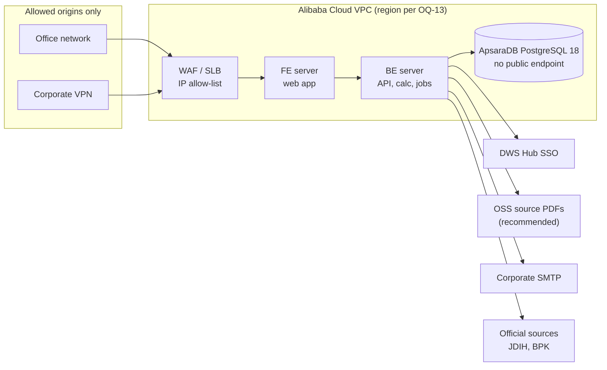

| Tier | Component | Notes |
|---|---|---|
| Edge | Alibaba Cloud WAF / SLB | Allow-list of office IP ranges and the VPN pool; TLS termination |
| Front end | FE server | Serves the web app; stores no business data |
| Back end | BE server | API, calculation, maker-checker workflow, scheduled jobs (status checks, source watch); DWS Hub SSO client |
| Database | ApsaraDB RDS for PostgreSQL 18 | Private subnet, no public endpoint; encrypted at rest; automated backups with point-in-time recovery; confirm PostgreSQL 18 availability in the region (OQ-13) |
| Documents | Alibaba Cloud OSS (recommended) | Private bucket for source PDFs and evidence packs; server-side encryption; SHA-256 kept in the database |
| Secrets | Alibaba Cloud KMS (recommended) | Encryption keys and SSO client secrets (NFR-SEC-03) |
| Environments | Development, UAT, production | Separate VPCs or accounts; production data never copied to development |

---

## 14. Data migration from the prototype

| Step | Activity | Owner | Exit criterion |
|---|---|---|---|
| M1 | Extract the 122 palm rows (the 21 non-palm rows are out of scope), band table (17 bands) and schedule metadata from the prototype JSON | Dev | Machine-readable staging file |
| M2 | Create Regulation records: Permenperin draft (status `DRAFT_RANCANGAN`), PP 55/2008 and PMK 214/2008 (duty collection), PMK 38/2024, PMK 68/2025, PMK 69/2025, PMK 9/2026 — **verify each number, date and annex against JDIH Kemenkeu and the BPK database (13.1)** | Maker | Source PDFs attached, Checker approved |
| M3 | Expand non-code HS text (e.g. `ex 4407 (all subheadings listed in Annex A)`) into explicit codes; assign BTKI version | Maker | DQ-02 clean |
| M4 | Map duty `rates[17]` → `BAND_USD_PER_MT`; `pctFlat` → `AD_VALOREM_PCT`; cocoa → `BAND_PCT`; levy `pct` → `PCT_OF_REF_PRICE`; `usd` → `FIXED_USD_PER_MT` (USD 0 → `ZERO_LISTED`) | Dev | Import dry-run passes |
| M5 | Fill gaps found in the review: missing definitions (4), missing parameters (13), mixture rules (PMK 69/2025 Lampiran B) | Maker | DQ warnings triaged |
| M6 | Load reference prices, Harga Ekspor (MK/BC) and KMK FX rates for at least the last 24 months, each with its source document | Maker | DQ-07 clean |
| M7 | Reconcile: calculated values at a USD 900 reference equal prototype outputs for all palm rows (except intentional fixes) | QA + Tax | Signed reconciliation report |
| M8 | Checker approval and publication of the initial version (v1) | Checker | Version 1 published |

---

## 15. Release plan (indicative)

| Phase | Duration | Content | Exit |
|---|---|---|---|
| Discovery & design | 3 weeks | Close open questions, UX prototypes, architecture & security design, Alibaba Cloud environments, DWS Hub SSO registration, golden test set from Tax | Design sign-off |
| MVP build — Sprints 1–2 | 4 weeks | DWS Hub SSO (F-13), IAM (F-01…F-12), network restriction (F-14), audit (F-50), configuration (F-52) | Security tests pass |
| MVP build — Sprints 3–4 | 4 weeks | Data admin (F-20…F-28), DQ (F-51) | Prototype data imported |
| MVP build — Sprints 5–6 | 4 weeks | Workflow (F-29, F-30), source verification (F-31), catalogue, calculator & PDF evidence pack (F-40…F-47, F-49) | Golden tests 100 % |
| Hardening | 3 weeks | Pen-test, performance, accessibility audit, migration M1–M8, UAT | No Critical/High; UAT sign-off |
| Go-live & hypercare | 2 weeks | Production launch, support | KPIs tracked |
| Release 2 | +8 weeks | Notifications, API, SIEM, automated source watch | — |

### 15.1 Build status (4 Nov 2026)

The MVP is being built in vertical slices; 124 automated tests run against PostgreSQL 18. Details per slice are in the repository README.

| Area | Functionalities | Status |
|---|---|---|
| Sign-in, sessions, logout, network allow-list | F-09, F-13, F-14 | Built |
| Accounts at first sign-in, identity conflicts | F-02, F-03 | Built |
| ECR authenticator, step-up, recovery codes | F-06 | Built |
| User administration with SoD-2/3/4, Super Admin bootstrap command | F-01, F-10 | Built |
| Audit trail, hash chain, nightly chain check, audit log page with search and CSV/XLSX export | F-50 | Built; narrower views for Makers, Checkers and User Admins not yet |
| Scheduled jobs: nightly data-quality check and dashboard, reference-price gap alert, dormant accounts, session clean-up | F-51, F-12 (dormancy), FR-DQ-01 | Built |
| Quarterly access reviews: keep or revoke each role assignment, 14-day escalation to Super Admins, signed PDF/A report for Auditors | F-12, L2-1.9 | Built |
| Configuration screen: session limits, step-up window, roles at first sign-in, office/VPN allow-list, disclaimer, within safe limits | F-52, FR-CFG-01 | Built; DWS Hub SSO settings shown read-only (deployment), email templates not yet |
| Regulation register, official source documents, virus scan | F-20, F-21, F-31 | Built |
| Commodities, products, HS codes, shared HS | F-22, F-23, F-24 | Built; full BTKI 2022 load pending (loader ready) |
| BK and PE schedules, band tables, reference prices, Harga Ekspor, FX | F-25, F-26, F-27 | Built |
| Maker-checker change sets, versions, history, impact preview, rollback | F-29, F-30 | Built |
| Workflow notifications (in ECR and by email), change subscriptions, change bulletins | F-48, FR-NTF-01 | Built (subscriptions brought forward from Release 2) |
| Excel bulk import with dry run and row-level report | F-28, FR-IMP-01 | Built |
| Catalogue, search, filters, KPI tiles, product detail, as-of date | F-40 to F-43, F-45, F-46 | Built |
| Calculator with what-if, saved calculations with replay check | F-44 | Built; golden test set pending (A3) |
| Permalinks, CSV/XLSX export, PDF/A evidence pack with verification page | F-47, FR-EXP-01/02/03 | Built, including large exports in the background (US-47-N1 AC3); veraPDF validation in CI not yet |
| Daily source watch: BPK status and amendments of registered regulations, new PMK and Kepmendag documents on official listings, new JDIH files, changed official PDFs; reported to Makers, never published | FR-SRC-03, FR-SRC-04 | Built (FR-SRC-04 brought forward from Release 2) |
| Web app layout: menu by role, home dashboard, light and dark themes, phone width, sticky table headers, visible keyboard focus | NFR-ACC-01, NFR-RSP-01 | Built; formal WCAG 2.1 AA audit and catalogue card view on phones not yet |
| Break-glass login and reset, own profile page, custom roles, language switch | F-05, F-07, F-08, F-11, F-49 | Not yet |

---

## 16. Risks & mitigations

| # | Risk | Likelihood | Impact | Mitigation |
|---|---|---|---|---|
| R1 | Rates or reference prices entered wrongly | Medium | High | Maker-checker, DQ rules, ±30 % warnings, golden tests, rollback |
| R2 | Classification regulation stays a draft or changes (incl. possible removal of HS codes from the Permenperin) | High | Medium | Status badges, effective dating, product identity decoupled from HS |
| R3 | Users treat ECR as legal advice | Medium | High | Disclaimer on all outputs; legal references always shown |
| R4 | Account takeover of a Maker/Checker | Low | High | Mandatory MFA, lockout, step-up, SoD, alerts |
| R5 | Slow regulation intake (Maker capacity) | Medium | Medium | Bulk import, R2 source monitoring, time-to-publish KPI |
| R6 | Scope creep into non-tariff obligations | Medium | Medium | Explicit non-goal; Release 3 module |
| R7 | Ambiguity in calculation base (Harga Ekspor vs. invoice; PEB date) | Medium | High | Duty base and date confirmed from PMK 214/2008; Tax/Customs to confirm the levy date and later amendments before build (OQ-02/03) |
| R8 | Personal-data non-compliance | Low | Medium | Data minimisation, privacy notice, PDP-compliant retention |

---

## 17. Assumptions, dependencies & open questions

### Assumptions
* A1 ECR is an internal web application reachable only from the office network and VPN.
* A2 DWS Hub assigns ECR to the right people and refuses sign-in for people not assigned (to be confirmed, OQ-14); a corporate email service exists for notifications.
* A3 Tax/Customs will provide a golden test set of ≥ 50 historical shipments.
* A4 Regulatory content in the prototype is a starting point only and will be re-verified against official sources.

### Dependencies
* D1 Availability of official regulation PDFs and monthly reference-price decrees.
* D2 BTKI (Indonesian tariff book) code list in machine-readable form.
* D3 Hosting platform, vault/KMS, backup and email services provided by IT.

### Open questions

| # | Question | Owner | Needed by | Status (30 Oct 2026) |
|---|---|---|---|---|
| OQ-01 | Which commodities are in MVP scope? | Business Owner | Discovery | **Answered:** palm oil, CPO and all derivatives, including mixtures. Non-palm commodities are out of scope; the model stays commodity-agnostic. |
| OQ-02 | What is the base for percentage-based duty and the cocoa levy? | Tax/Customs | Discovery | **Mostly answered:** the Harga Ekspor set per period by MK/BC decision, not invoice or FOB (PMK 214/2008 Art. 4(2), 5(2); PMK 69/2025 Art. 8(4)). Remaining: confirm the 2014 and 2016 amendments to PMK 214/2008 left Articles 4–5 unchanged. Palm duty itself is a fixed USD/MT amount, so this matters only if other commodities return. |
| OQ-03 | Which date sets the rate, and which FX rate applies? | Tax/Customs | Discovery | **Partly answered:** duty uses the PEB registration date (PMK 214/2008 Art. 5(1)); FX for duty and levy is the KMK rate on the payment date (PMK 214/2008 Art. 5(3); PMK 69/2025 Art. 9). Remaining: which date sets the levy rate — not stated in PMK 69/2025; the build uses the PEB date until BPDP confirms. |
| OQ-04 | Is public access needed? | Business Owner | Sprint 1 | **Answered:** no. Office network and VPN only (F-14, NFR-SEC-07). |
| OQ-05 | How and when is SSO delivered? | IT Security | Discovery | **Answered:** DWS Hub SSO, in the MVP (F-13). Integration details in OQ-12. |
| OQ-06 | Retention period for audit log and versions (proposed 10 years)? | Legal | Sprint 1 | **Answered:** 10 years, aligned with tax-record retention (BR-AUD-02). |
| OQ-07 | Who are the initial named Makers and Checkers, SoD-compliant? | Business Owner | Before UAT | **Deferred:** to be assigned per role later. |
| OQ-08 | What evidence format is needed? | Tax | Sprint 5 | **Recommended, awaiting confirmation:** XLSX/CSV for working data plus a PDF/A evidence pack per calculation with an evidence ID, content hash, source-document SHA-256 and an internal verification link (FR-EXP-02, now MVP). Add a certified e-signature only if Tax or external auditors require it. |
| OQ-09 | Target hosting stack? | IT | Discovery | **Answered:** Alibaba Cloud with FE server, BE server and ApsaraDB RDS for PostgreSQL 18 (13.2). |
| OQ-10 | Do the PMK 9/2026 levy rates in the prototype (e.g. 12.5 % for CPO) match its Lampiran A? So far only news reports confirm them. | Tax/Customs | Sprint 3 | Open |
| OQ-11 | Do JDIH Kemenkeu and the BPK database permit scheduled fetching, or can an official data feed be requested? No public API was found. | IT, Legal | Sprint 3 | Open |
| OQ-12 | DWS Hub SSO details: protocol (OIDC or SAML), claims (verified email, employee ID), whether it reports MFA, single logout, group-to-role mapping. | IT, DWS Hub team | Sprint 1 | **Mostly answered** by the DWS Hub strict OIDC contract: authorization code + PKCE (S256), ID token verified via JWKS, `sub` as user key, `email` and `name` as profile only, 60-second ID token, no refresh token. Gaps: no MFA or sign-in-time claim (T-01), no logout endpoint (T-05), no `email_verified` (T-06), no group claims (roles stay in ECR), no leaver signal (T-10) — see the Technical Design. |
| OQ-13 | Alibaba Cloud region (Jakarta recommended for data residency under UU 27/2022), PostgreSQL 18 availability on ApsaraDB there, and OSS for source documents. | IT | Discovery | Open; also confirm ApsaraDB allows the `btree_gist` and `citext` extensions, which the schema uses |
| OQ-14 | Does DWS Hub refuse sign-in to ECR for people who are not assigned the application? If not, the default role at first sign-in must be empty (BR-IAM-12). | DWS Hub team | Before UAT | Open |
| OQ-15 | Real PMK 38/2024 band amounts, reference prices and decrees for the initial load (the walkthrough data so far is test data). | Tax/Customs, Maker | Migration M2–M6 | Open |

---

## 18. Glossary

| Term | Meaning |
|---|---|
| **BK — Bea Keluar** | Export duty collected by Customs (DJBC) |
| **PE — Pungutan Ekspor** | Export levy collected for the plantation fund agency (BPDP, formerly BPDPKS) |
| **PMK** | *Peraturan Menteri Keuangan* — Minister of Finance Regulation |
| **Permenperin** | *Peraturan Menteri Perindustrian* — Minister of Industry Regulation (palm-derivative classification) |
| **Kepmendag** | *Keputusan Menteri Perdagangan* — Minister of Trade Decree (reference prices, Harga Ekspor) |
| **Lampiran / Kelompok** | Annex / group within an annex |
| **Uraian** | Official description text of a tariff line |
| **HS / BTKI** | Harmonized System code / *Buku Tarif Kepabeanan Indonesia* (8-digit national tariff book) |
| **ex code** | Only part of an HS subheading, qualified by a description |
| **Reference price (Harga Referensi)** | Periodic price (e.g. CPO, cocoa) used to determine the duty band and levy |
| **Harga Ekspor (HE)** | Export base price for ad-valorem BK and the cocoa levy, set per period by MK/BC decision (Customs, for the Finance Minister) from the Trade Ministry's export price decree |
| **KMK rate** | *Kurs Menteri Keuangan* — official FX rate for customs/tax |
| **PEB** | *Pemberitahuan Ekspor Barang* — export declaration |
| **Shared tariff post** | One HS code used by several products that may carry different charges |
| **Maker / Checker** | Person who prepares a change / independent person who approves it |
| **SoD** | Segregation of duties |
| **MFA / TOTP** | Multi-factor authentication / time-based one-time password |
| **WIB** | Western Indonesia Time (UTC+7) |

---

## 19. Appendix — Traceability from prototype critique to requirements

| Review finding (doc 01) | Addressed by |
|---|---|
| S1 Palm-only scope | FR-PRD-01, FR-TRF-01/02, F-22, M5, OQ-01 |
| S2 Non-palm levy missing | FR-TRF-02, F-26, M5 |
| S3 No regulation register | FR-REG-01/02, F-20, F-21 |
| S4 No time dimension | Effective dating (§9.1), F-27, F-45, BR-CAL-01 |
| S5 Non-tariff obligations | Non-goal v1; `other_obligations_note`; Release 3 module |
| S6 Unverified/draft content | DQ-10, US-43-N1, M2 |
| F1 Default sort | US-40-P1 AC2 |
| F2/F3 Tiles don't reconcile | F-46 |
| F4 Mixed units | US-40-N1, US-42-N1, BR-CAL-04 |
| F5 Cocoa not calculable | `BAND_PCT` basis, US-25-P2 |
| F6 No quantity/IDR | F-44, BR-CAL-04/05 |
| F7 Truncated *uraian* | US-43-P1 AC1 |
| F8 Confusing shared-HS text | US-43-P1 AC3 |
| F9 HS search format | US-41-P1, FR-PRD-03 |
| F10 Non-code HS cell | BR-PRD-03, US-24-N1, M3 |
| F11 "No charge" ambiguity | BR-CAL-06, US-44-N2 AC2 |
| U1–U3 Sticky header / mobile / accessibility | NFR-ACC-01, NFR-RSP-01, US-40-P1 AC4, US-42-P1 AC2 |
| U4 Scale | NFR-PRF-01, NFR-SCL-01 |
| U5 Language | F-49, NFR-L10N-01 |
| U6 Export / permalink | F-47 |
| G1–G4 Governance & security | F-01…F-12, F-29, F-30, F-50 |
| G5 Effective dating | §9.1, F-27, F-45 |
| G6 Numbering defects | BR-PRD-02, DQ-04, US-23-P2 |
| G7 BTKI version | FR-PRD-03, DQ-02 |

---

*Disclaimer: This PRD describes a reference and calculation tool. Regulation numbers, rates and calculation bases cited from the prototype must be verified against the official published regulations before the system is used for customs declarations or financial reporting.*
